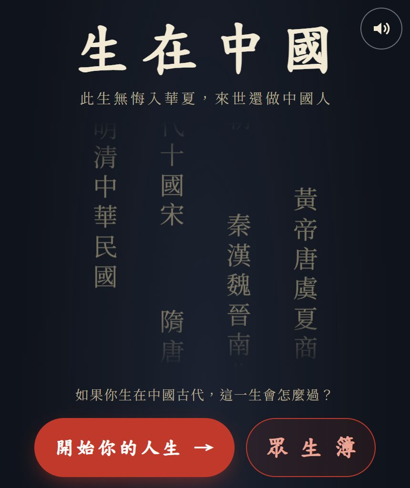
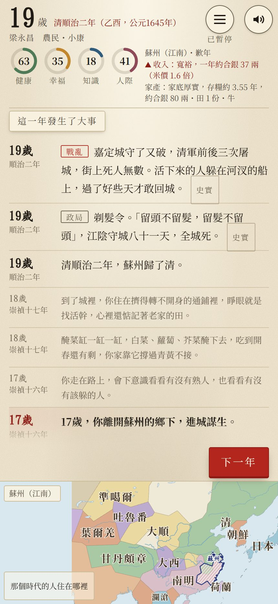
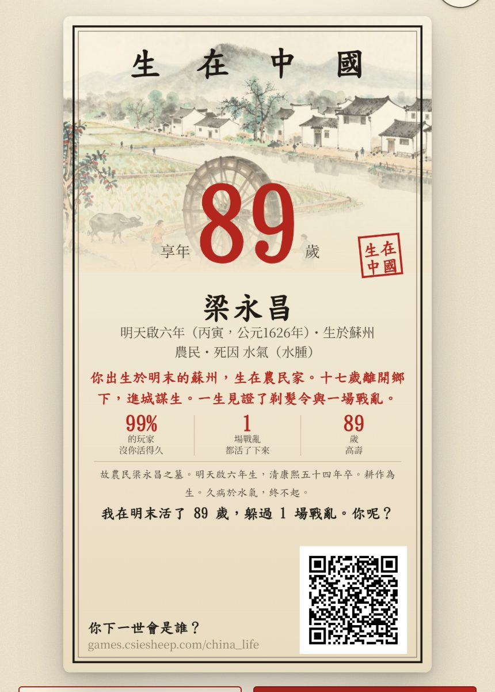
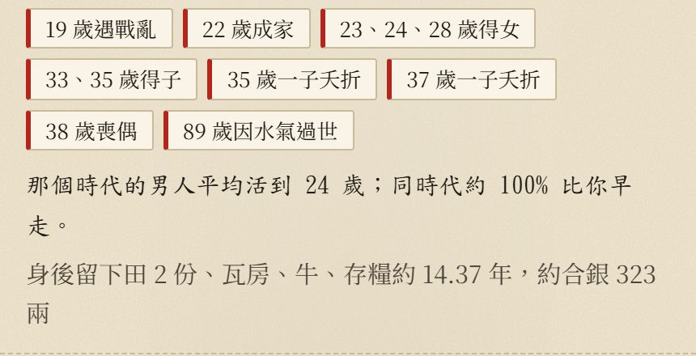
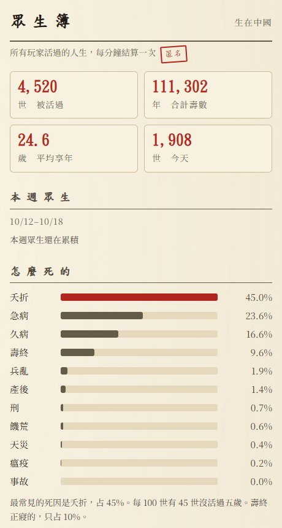

# 【遊戲開發日記】生在中國：如果你投胎到中國古代，能活到幾歲?

小時候讀歷史課本，
讀到的都是皇帝、將軍、宰相。
秦始皇統一六國、唐太宗貞觀之治、康熙平三藩……

但我一直有個疑問：
**那時候的普通人，過的是什麼日子?**

如果我不是生在現在的台灣，
而是隨便被丟進兩千年裡的某一年、某一個地方，
我會是誰?
能活到幾歲?

想了很久，
最後決定——不如做一個遊戲來回答自己 XD

這就是 **《生在中國》**：
一個投胎到中國歷史的人生模擬器。

👉 線上玩：<https://games.csiesheep.com/china_life/>（免安裝、免登入，手機也能玩）

---

## 一、怎麼玩?其實你什麼都不能選

按下「開始你的人生」，
遊戲會在公元前 400 年到 1940 年之間，
幫你抽一個出生的年份、地方和家庭。

抽法不是平均的，是照**出生人數加權**——
人多的時代比較容易抽到。
所以你抽到清朝的機會，比抽到秦朝大很多。
（秦朝也才十五年，想抽到也不容易 :p）

然後你會拿到一張「戶帖」：

這一世我叫**梁永昌**，
明天啟六年（公元 1626 年）生於蘇州，
農民，家境小康。

注意最下面那兩格：
**平均壽命約 24 歲，五歲前夭折 46%。**

是的，你沒看錯。
在那個時代，差不多每兩個孩子就有一個活不過五歲。

接下來就是一年一格地往下活。
畫面上有健康、幸福、知識、人際四個儀表，
下面是人生紀錄：史事、家裡的大小事，還有那個時代的日常小事。
少數時候會停下來問你：
十五歲要不要讀書應考?饑荒要不要逃荒?十八歲要不要進城?

---

## 二、梁永昌的一生：剛好撞上改朝換代

我讓梁永昌自己往下活。
十七歲，他離開蘇州鄉下，進城謀生。
十九歲那年，是清順治二年——1645 年。

這一年的紀錄是：
蘇州一帶戰事吃緊，他設法躲過了徵召；
剃髮令下來了，「留頭不留髮，留髮不留頭」；
然後，「蘇州歸了清」。

旁邊的地圖上，
清、南明、大順、大西同時存在——
課本裡一行字帶過的「明清之際」，
對一個十九歲的蘇州年輕人來說，就是天翻地覆的一年。

好消息是，梁永昌是個很硬的人。

他活到了 **89 歲**，康熙五十四年才過世。
但看一下他的一生大事：

二十二歲成家，生了三個女兒、兩個兒子；
三十五歲、三十七歲，兩個兒子先後夭折；
三十八歲，妻子過世。

就算是「比 99% 的玩家活得還久」的人，
也一樣要送走自己的孩子。
這大概是做這個遊戲，最讓我心裡一沉的地方。

---

## 三、真的嗎?古代人平均只活二十幾歲?

做之前，我自己也有一個疑問：
「古人平均只活三十歲」，這種說法到底是真的嗎?

查了資料之後，答案有點微妙：

1. **平均壽命低，主要是因為小孩死太多。**
   只要撐過了童年，活到五六十歲並不稀奇。
   平均數被大量夭折拉下來了。
2. **1949 年以前，中國根本沒有逐年的壽命統計。**
   遊戲裡的數字，是用 1929–31 年的農村調查（平均壽命在 25 以下到 35 之間）、
   遼寧的戶口冊、族譜研究和模型生命表，一點一點往回推的。
3. **越早的年代，推估的成分越高。**
   所以遊戲裡每個數字都標了信心等級：
   「史料」「學界估計」「模型推估」三種，
   人口主要參考葛劍雄主編的《中國人口史》，
   1950 年以後則用聯合國《世界人口展望 2024》的數字。

我一開始測試的時候，
第一個抽到的人叫周喜鳳，清康熙年間生於揚州的農家女孩：

天花，未滿周歲。
從出生到結局，不到二十秒。

我愣了一下，
以為是程式寫錯了。
回頭去查表——沒錯，那個時代就是這樣。

遊戲上線後有個「眾生簿」，統計所有玩家活過的人生（匿名，只收時代、身分、享年、死因這些數字）。
截至我寫這篇的時候：

- 已經被活過 **4,520 世**，合計 111,302 年
- 平均享年 **24.6 歲**
- 最常見的死因是**夭折，45%**
- 壽終正寢的，只有 **10%** 不到

另外我自己用程式跑了 100 局試玩，
十局有八局是農民，
而 100 局裡，**考上功名的人是 0 個**。

所以如果你玩了幾次都在種田、都很早就走了，
不是你運氣不好——
那就是歷史上大多數人的人生 orz

---

## 四、怎麼做出來的?一個人 + 一群 AI

這個遊戲是我在 2026 年 10 月 16 日開工的，
到寫這篇文章的 10 月 20 日，git 上已經有 800 多個 commit。

當然不是我一個人敲出來的。
我的做法是當「專案經理」，
把工作拆成一張一張的 issue，
交給不同分工的 AI 代理人：
寫引擎的、做畫面的、寫文字的、畫圖的，
各自在自己的分支上做，做完要先通過驗證才能合併。

這其實就是我十幾年前寫〈如何減少寫程式的風險〉時的老想法：
「最大的風險來自無知，要減少風險就是要減少不確定的因素。」
只是現在的不確定因素，多了一個——
**AI 說它做完了，真的嗎?**

所以這個專案最花力氣的，反而不是寫程式，是驗證：

- **資料是唯一的真相**：42 個時期、每個時期 49 個欄位（人口、各地區份額、壽命、死亡率、身分比例、科舉、纏足、米價……），每個數字都有出處。
- **模擬要回得到統計**：每個時期用壽命和死亡率合成生命表，跑一大批人生，確認結果回到原本輸入的數字。
- **畫面要真的有人看過**：有自動的畫面驗收，也有人一局一局讀紀錄、挑毛病。

挑出來的毛病還真不少，例如：
女生被問要不要「花錢買個功名」、
人人都生在省會、
選了「不纏足」，日常句卻寫「母親把你的腳裹上了布」……
這些都是讀了 100 局人生才發現的。

現在遊戲裡有 600 多條歷史事件、近三千句日常小事、48 張時代插圖（用本機的 AI 圖像模型畫的水墨示意圖，不是史料，不能拿來考據喔）。

---

## 五、有錯請指正

靈感來自一個叫 [1in8b.life](https://1in8b.life/) 的網站——
隨機出生在 172 個國家之一，活完一生。
我把「國家」換成「中國的某個時代、某個地區」，
程式、資料和文字都是自己重新做的。

必須誠實講的限制：

- 1949 年以前的壽命都是**模型推估**，只保證量級和方向。
- 地區只分十大區，身分只分六類，少數民族、宗教、地方細節幾乎沒有納入。
- 日常句是依時代通識寫的虛構小事，可能還有時代錯置。

小弟不是歷史專業，
如果你玩到哪裡覺得「這不對吧?」，
非常歡迎留言告訴我 :)

---

最後，
如果你也好奇自己會投胎成誰，
可以去試試看：

👉 **[生在中國](https://games.csiesheep.com/china_life/)**

活完一世，
說不定你也會跟我一樣，
有點感謝自己生在現在 :)

\#生在中國 #下一世會是誰 #又夭折了orz
