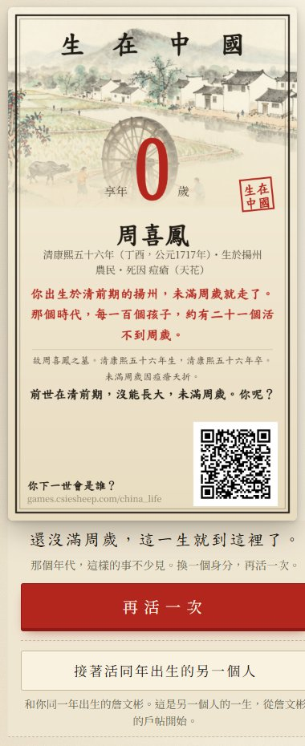
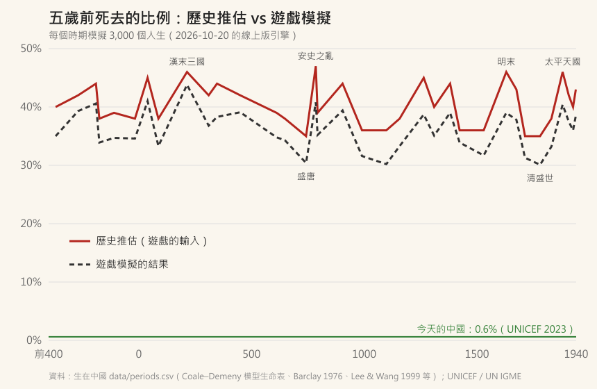
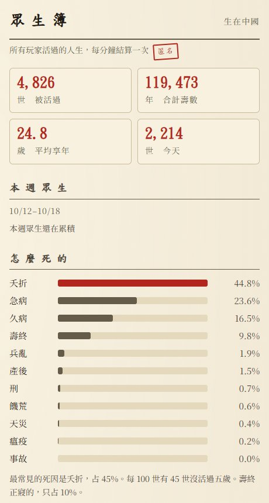

# 【生在中國】古代的孩子，有四成活不過五歲——做遊戲時被數字嚇到

做《生在中國》的時候，
我測試的第一局，
是一個叫周喜鳳的女孩，
清康熙五十六年生在揚州的農家。

天花，未滿周歲。
從按下「出生」到結局，不到二十秒。

我第一個反應是：
**一定是 bug。**

結果回頭去查表、跑統計，
發現程式沒有錯——
錯的是我對「古代」的想像。

---

## 一、數字到底有多高?

遊戲裡每個時期，都有一個「五歲前夭折率」的欄位。
我把 42 個時期拉出來看：

- **最好的時代**（盛唐、清盛世）：大約 **35%**
- **一般的時代**：大約 **38–40%**
- **亂世**（漢末三國、安史之亂、明末、太平天國）：**46–47%**

也就是說，
就算生在所謂的「盛世」，
三個孩子裡也有一個活不過五歲。
碰上亂世，差不多就是擲硬幣。

那今天呢?
UNICEF 的資料，中國 2023 年的五歲前死亡率是 **千分之 6.1**，
也就是 0.6%（[UNICEF](https://data.unicef.org/country/chn/)）。
連 1990 年都還有千分之 53.6。

古代的 40%，和今天的 0.6%，
差了大概 **六十幾倍**。

---

## 二、真的嗎?這些數字是哪來的?

看到 40%，我自己的第一個問題也是：
**真的嗎?古代哪來的統計?**

答案是：**沒有。**
1949 年以前，中國沒有逐年的人口動態統計。
遊戲裡的數字，是從幾個比較可靠的錨點，一點一點推回去的：

1. **1929–31 年的農村調查**
   金陵大學 J. Lossing Buck 的土地利用調查，是民國時期很重要的一份農村調查。
   1935 年 Seifert 根據它做的生命表，男女的平均壽命都只有 35 歲左右，
   大約每六個嬰兒就有一個活不過一歲（[Milbank Quarterly 1935](https://www.milbank.org/wp-content/uploads/mq/volume-13/issue-03/13-3-Life-Tables-for-Chinese-Farmers.pdf)）。
2. **但這個數字被認為太樂觀**
   1976 年 Barclay、Coale 等人重新分析同一份調查，
   認為原始資料有漏報、把死亡算少了，
   重估之後，男女的平均壽命都**不到 25 歲**。
3. **清代的族譜和戶口冊**
   James Lee（李中清）和 Wang Feng 的《One Quarter of Humanity》、
   Lee 和 Campbell 用遼寧 1774–1873 年的戶口冊做的研究，
   是遊戲裡清代死亡率的主要依據。
4. **模型生命表**
   有了「平均壽命大約幾歲」，
   再用人口學常用的 Coale–Demeny 模型生命表，
   換算成嬰兒和五歲前的死亡率。
   平均壽命 25 歲，大約對應五歲前死亡 45%；30 歲大約 38%；35 歲大約 35%。

所以遊戲裡每個數字，都標了信心等級：
清代以後是「學界估計」，
更早的時代是「模型推估」——只保證量級和方向，不保證小數點。

如果你覺得這只是中國的特例，
Our World in Data 整理過一份研究：
Volk 和 Atkinson 2013 年彙整了歷史上和狩獵採集社會的資料，
平均大約 **27% 的嬰兒活不過一歲，將近一半的孩子活不到青春期**。
那篇文章的標題很直接：每兩個孩子，就死一個（[Our World in Data](https://ourworldindata.org/child-mortality-in-the-past)）。

---

## 三、遊戲跑出來的結果

資料是一回事，
遊戲跑出來對不對，又是另一回事。

我用遊戲的引擎，每個時期各模擬了 3,000 個人生，
把「五歲前死去的比例」畫出來：

紅線是歷史推估（也就是遊戲的輸入），
黑色虛線是遊戲實際跑出來的結果。

形狀幾乎一模一樣：
盛世低、亂世高，
三國、安史之亂、明末、太平天國，一個一個尖峰都對得上。

但你會發現，黑線**整條比紅線低了 3–5 個百分點**。
這不是 bug，是我故意的。

---

## 四、貴在真實，但真實到我自己受不了

遊戲剛做好的時候，
隨機出生的人生裡，五歲前死去的比例是 **39.8%**，
跟歷史推估幾乎一樣。

結果自己一直玩，
五局有兩局，按下出生沒多久就結束了。
真實是真實，
但玩的人大概會直接關掉 orz

所以我做了一個決定：
把玩家自己這一世、五歲以前的死亡風險，調低一點，
讓隨機出生的人生裡，五歲前死去的比例變成 **35%**。

但只調這一個地方。
你長大之後生的孩子，
還是照原本的歷史數字在走。

我跑了兩萬個人生，挑出「1900 年以前出生、活過 45 歲、有生孩子」的 5,783 個人：

- 平均每個人生了 **4.9 個孩子**
- 孩子裡有 **40%** 活不過五歲
- **86%** 的人，至少送走過一個孩子
- **59%** 的人，送走過兩個以上

上一篇的梁永昌活到 89 歲，
生了七個孩子，三個沒有長大。
在遊戲裡，這不是特別悲慘的人生，
這就是那個時代大部分父母的人生。

遊戲上線以後，有個「眾生簿」統計所有玩家活過的人生（匿名，只收時代、身分、享年、死因這些數字）：

截至我寫這篇的時候，玩家活過 **4,826 世**，
**44.8%** 的死因是夭折，
壽終正寢的不到 10%。

眾生簿的比例比我模擬的還高，
一部分是因為裡面包含調整以前的人生，
其他原因我還在查。
（工程師的老毛病，數字對不上就睡不著 XD）

---

## 五、所以「古人只活三十歲」是真的嗎?

一半對、一半錯。

平均壽命二三十歲，**是真的**，
但主要是被大量夭折拉下來的。

只要撐過了童年，
活到五六十歲並不稀奇。
2026 年一篇 NBER 的工作論文，用 1298–1775 年出生的族譜樣本算過：
已婚男性的典型壽命大約 **52 歲**，
身分高的人，還多活了大約 7 年（[NBER w35396](https://www.nber.org/papers/w35396)）。

所以真正可怕的不是「古人活不久」，
而是：
**每個家庭，幾乎都要送走自己的孩子。**

---

## 六、寫在最後

我以前寫過一句：
「最大的風險來自無知，要減少風險就是要減少不確定的因素。」（〈如何減少寫程式的風險〉）
做這個遊戲，算是用另一種方式，把「不知道」變成「知道」。

身為兩個小孩的爸，
看著這些數字，
心裡還是有點沉。

0.6% 和 40% 之間，
是疫苗、抗生素、乾淨的水、還有產房裡的醫生護士。
這些我們覺得理所當然的東西，
其實是很近代才有的。

如果你也想看看自己生在古代會怎樣，
可以去活一次：

👉 **[生在中國](https://games.csiesheep.com/china_life/)**

數字都有出處，有錯請指正 :)

\#生在中國 #貴在真實 #又夭折了orz
