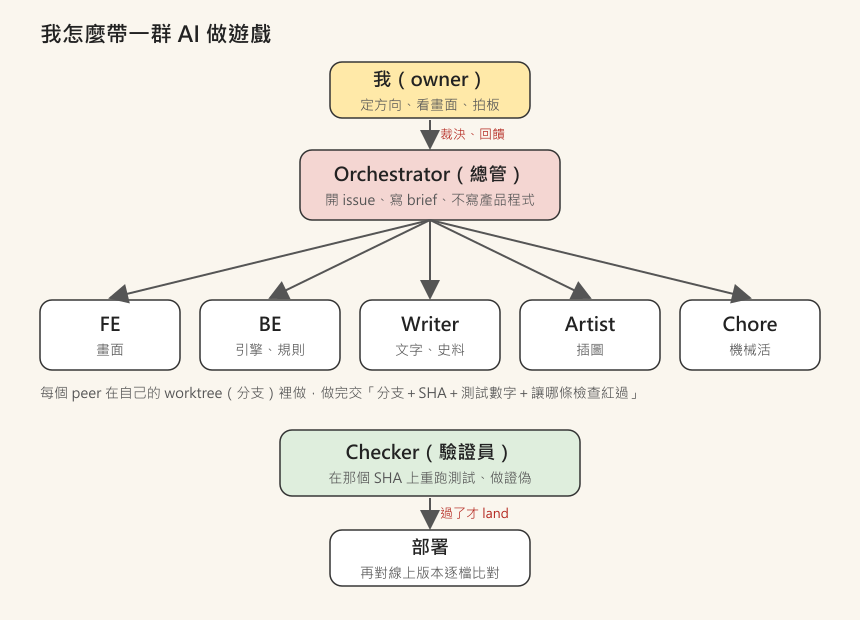

# 【遊戲開發日記】一個人用 AI 做了 10 款網頁遊戲：分工、驗證與踩過的坑

2026 年 8 月，
我用 AI 幫最愛的桌遊《山中小屋》做了一塊音效板，
那時候覺得：哇，這個好玩。

兩個多月後，
[games.csiesheep.com](https://games.csiesheep.com/) 上已經有 **10 款網頁遊戲**，再加上那塊音效板。

有單人的，有開房間找朋友一起玩的；
有改編桌遊的（殭屍、天地會、抵抗組織、Dice Wars），
有歷史的（縱橫、生在中國），
也有小時候自己發明的遊戲（無聊遊戲簿）。

我把這幾個 repo 的 git log 加起來，
**大約 3,000 個 commit**。
其中最大的《生在中國》，從 10 月 16 日開工到現在，就有 900 多個。

聽起來很厲害?
其實大部分的時間，
我都在跟「AI 說它做完了，真的嗎?」奮鬥 XD

---

## 一、一開始：一個 AI 從頭做到尾

最早的《Zombie in My Pocket》和《三更：殭屍》，
是一個 AI session 從規則、畫面、測試一路做完。

小遊戲這樣做很快，
但遊戲一大，問題就來了：

- 寫程式的是它、寫測試的是它、說「測過了」的也是它
- 三份東西都出自同一個腦袋，**錯的時候會一致地錯**
- 我只能一直點、一直玩，用肉眼找 bug

這讓我想到以前在新創寫過的一句話：
「最大的風險來自無知，要減少風險就是要減少不確定的因素。」（〈如何減少寫程式的風險〉）

AI 寫程式不是問題，
**不知道它寫的對不對，才是問題。**

---

## 二、後來：把 AI 當成一個團隊

大概從《Elevator Inc.》開始，我換了做法：
讓 AI 分工，像一個小團隊。

- **我（owner）**：定方向、看畫面、拍板。
- **Orchestrator（總管）**：一個主要的 AI session，負責開 issue、寫工作說明、派工、驗收。
  它有一條死規定：**不寫產品程式**。一旦自己寫，就變成自己驗自己了。
- **Peer（組員）**：前端、引擎、文字史料、插圖、機械活，各自一個 AI，各自在自己的分支上做。
  吃重的引擎用最強的模型，搬檔改名這種機械活，就用便宜的小模型。
- **Checker（驗證員）**：不看組員的報告，自己在那個 commit 上重跑測試。

組員交件時，要交固定的五行：
分支和 SHA、測試數字、**我讓哪一條檢查紅過**、我改了哪些不是我的檔案、**我沒驗到什麼**。

最有用的是最後一行。
組員說「部署前測不到這三件事」，
那就正好是總管部署後唯一要親手做的事。

我在筆記裡寫過一句，到現在還是覺得最重要：
**驗證的價值，不在於「我看過了」，而在於「我讓它紅過一次」。**

一條從來沒紅過的檢查，
你不知道它是在保護你，
還是根本沒在動。

---

## 三、踩過的坑

做了兩個多月，總管把踩過的坑記成一份「失敗目錄」，
現在有六十條。挑幾條最有代表性的：

### 1. 兩個組員各自發明了同一個東西

電梯遊戲裡，兩個組員平行加乘客。
結果兩邊各自定義了 **id 一樣、內容完全不同** 的乘客：
一個很有耐心會卡門，一個永遠不付錢。

git 看起來沒衝突（都是往清單尾巴加），
兩邊的測試也都是全綠——
因為問題只在兩邊合起來的時候才存在。

後來的規定是：**開工第一件事，先列出你要用的所有新 id**，由總管擋掉撞名的。
然後下一次還是撞了，這次撞的是「成就」——
同一個檔案裡有幾張表，就有幾個要檢查的地方 orz

### 2. 組員卡了一小時，因為它去問了「我」

有一次一個組員做完、驗完，卻停了一小時不交。
總管以為它當機了，
結果它是**跑來問我（owner）可不可以 push**。

從組員的角度看，人類才是它的老闆。
所以後來每份工作說明都要寫死三欄：
**不必問直接做的、要先問總管的、不要問 owner 的。**
只講「有問題回報我」，它就會停在每一個地方。

### 3. 測過的，不是部署上去的

《生在中國》有一次測試全綠，部署上去整頁空白。

原因是部署前會挑檔案打包，
新加的地圖資料夾不在清單上，線上載不到。
所有的測試都在原始資料夾跑，**沒有一條看過打包後的那一份**。

現在部署前，會對打包後的檔案再檢查一次。

### 4. 檢查本身，會讓組員去「迎合」檢查

《生在中國》有一條檢查，用關鍵字判斷每句日常小事屬於哪種身分。
這條規則是總管自己寫的，有誤判。

組員不能改檢查，
最省事的路，就是**改句子去討好檢查**。
燈是綠了，但綠燈背書的是分類器的偏見。

後來交件要多列一欄：「我為了過檢查改了什麼」。
那次一列，列出了 11 句。

### 5. 自己的檢查，污染了真實的數字

這條最尷尬。

遊戲上線後，Google Analytics 說一半的使用者在美國，
公開的統計頁說兩天就活了將近五千世。

真的嗎?
其實很大一部分是**總管自己部署後的自動檢查**：
每次開一個全新的無頭瀏覽器，自動玩幾十局。
每一次都「只是看一下」，加起來比真實玩家還多。

現在網址加上 `?internal=1`，就不會送出任何統計。
（所以我上一篇文章引用的眾生簿數字，裡面也有一部分是這種檢查，有錯請指正 orz）

---

## 四、我學到的三件事

**1. AI 很會寫程式，但不會懷疑自己。**
所以「誰來懷疑」要設計進流程裡，不能靠運氣。

**2. 規則要在第一次就寫進去，不能出事再補。**
同一個坑，每個沒拿到那條規則的組員，都會各自踩一次。

**3. 我的工作從「寫程式」變成「定義什麼叫做完」。**
這其實跟以前帶團隊很像：
先定義問題、定義介面、定義怎麼驗收，
剩下的，交給專業的人（或 AI）。

---

## 五、寫在最後

2009 年讀 Woz 的自傳時，我寫下一個志向：
想擁有能力和熱情，做出一些真的能讓人生活更方便、更好玩的東西。

沒想到十幾年後，
是 AI 讓一個工程師爸爸，有機會一個人做出 10 款遊戲。

但也因為是 AI，
我比以前更常問自己那句老話：
**真的嗎?**

如果你想看看這些遊戲：

👉 **[games.csiesheep.com](https://games.csiesheep.com/)**

小弟經驗不足，這套做法還在一直改，
歡迎大家指教 :)

\#AI不會懷疑自己 #我讓它紅過一次 #又一個坑orz
