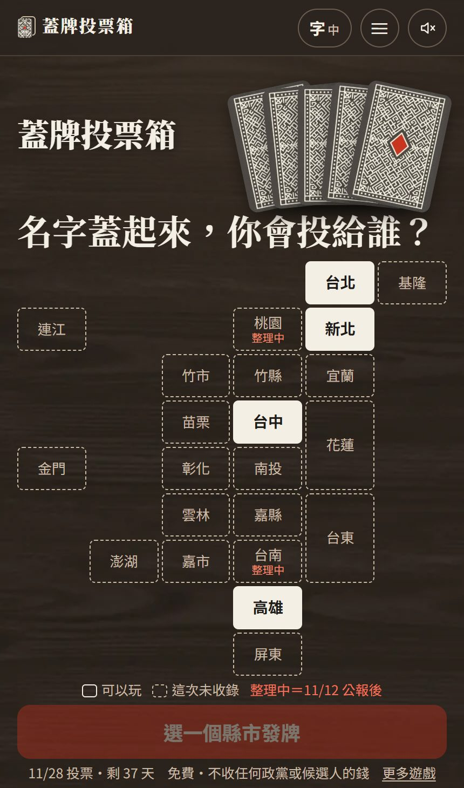
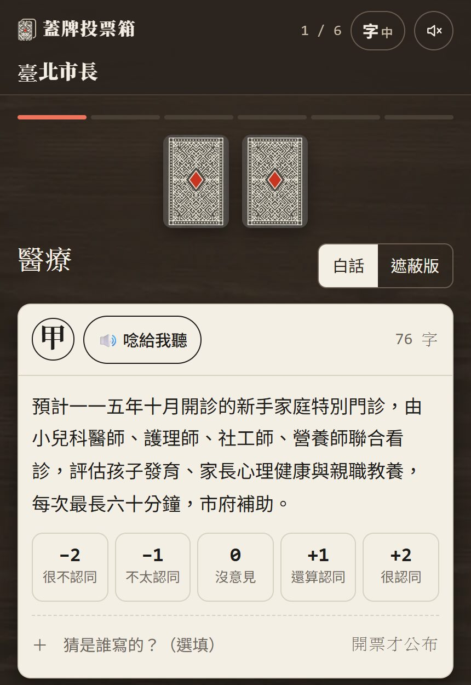
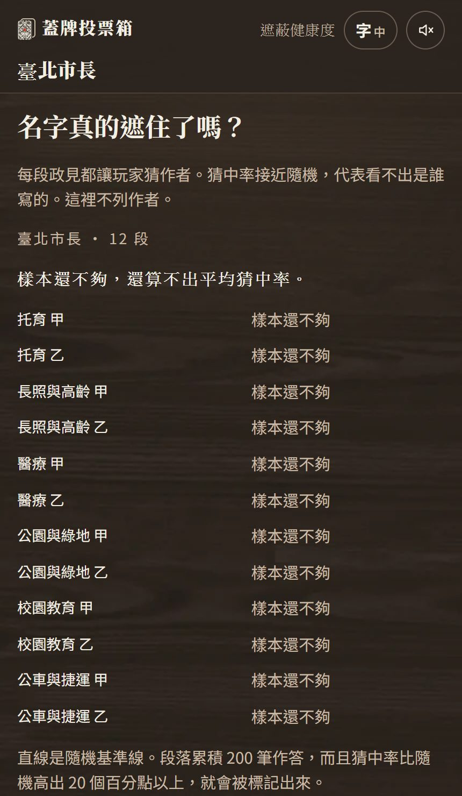

# 【遊戲開發日記】蓋牌投票箱：把名字蓋起來，你還會投給同一個人嗎?

11 月 28 日要投票了。
身邊的人聊選舉，
聊的大多是人、是黨、是誰又說了什麼。

但我一直很好奇一件事：
**如果把名字蓋起來，只看政見，**
**我們還會選同一個人嗎?**

所以我做了一個小遊戲：

👉 **[蓋牌投票箱](https://games.csiesheep.com/covervote/)**

---

## 一、靈感：留白投票所

這個點子不是我先想到的。
網路上已經有一個很紅的 [留白投票所](https://blindvote.app/)，
把各候選人的政見遮掉名字，讓你一輪一輪選。

我玩了一局台北，覺得很有意思，
也很佩服作者把每段政見都附上出處和日期。

玩完之後，我心裡冒出幾個「那如果…」：

- 那如果我本來就有想投的人，結果跟遮名之後選的不一樣呢?
- 那如果兩段我都不喜歡，或兩段都喜歡呢?
- 那如果名字遮了，大家其實還是一眼看得出是誰寫的呢?

這三個問題，就變成了蓋牌投票箱的三個核心。

---

## 二、怎麼玩

**1. 先說你傾向誰（可以跳過）**
選一個縣市，先選你目前比較想投的人，或「還沒決定」「不想說」。
這個答案**只存在你自己的瀏覽器，不會送出**。

**2. 名字蓋起來，給每段政見打分**
每一輪一個議題，例如托育、醫療、公車與捷運。
每段政見都蓋上牌、順序打亂，
你給它 **−2（很不認同）到 +2（很認同）**。

這是我最想改的地方：
二選一的時候，每輪只能投一段，
兩段都不要、兩段都喜歡，都表達不出來。
打分就沒有這個問題，政見收得少的候選人，也一樣算得出分數。

**3. 順便猜猜是誰寫的（選填）**
每段都可以猜作者，開票才公布。

**4. 開票**
看你「傾向的人」和「最契合的人」是不是同一個，
再把每張牌翻過來：誰寫的、原文、出處連結、日期。

---

## 三、名字真的遮住了嗎?

這是我覺得最重要、也最工程師的一個設計。

政見遮掉名字，
不代表就真的看不出是誰。
有在看政治新聞的人，常常看到一個建設名稱就猜到了。

那要怎麼知道遮得好不好?
**真的嗎?不如讓大家猜猜看。**

每段政見，大家都可以猜作者。
如果猜中率跟亂猜差不多，代表真的看不出來；
如果某一段累積了 200 筆作答，猜中率又比亂猜高出 20 個百分點以上，
就會被標出來，代表這段遮得不夠好，要重寫。

這些數字公開在「遮蔽健康度」頁：

（剛上線，現在每一段都還是「樣本還不夠」XD）

中立這件事，
與其靠我自己說「我很中立」，
不如讓玩家的猜測來證明。

---

## 四、分數怎麼算

我很怕大家把結果當成投票建議，
所以算法全部寫在「怎麼算」頁：

- 每位候選人的分數 = 你給他那幾段的平均分 × 50，所以落在 −100 到 +100
- 你標成重要的議題，分數算兩倍
- 只有一位候選人提出的「加分題」不計分；你跳過的段落也不計分（不是當成 0 分）
- 段落少於 3 段時，會標示「只有 n 段」，提醒你參考就好

**契合分數只反映你這一局打的分，不是對任何候選人的評價，也不是投票建議。**

---

## 五、幾個堅持

- **免費**，不收任何政黨或候選人的錢。
- **你傾向誰不會上傳**；網站流量用 Google Analytics 看，但不送任何跟政治有關的資料，也不做工作階段錄製。
- **依選罷法第 53 條**，投票日前十天起不得發布民調資料，
  所以 11 月 18 日起，所有跟候選人有關的匯總統計會**自動停止顯示**。
- 白話版和遮蔽版是改寫過的，拿掉了姓名、黨名和品牌政策名；**開票後每段都能看原文和出處**。
- 有「唸給我聽」和三段字體大小，方便長輩使用；也有課堂版，讓老師帶學生一起玩。

---

## 六、一天做完?

說來有點誇張：
這個遊戲從第一個 commit 到上線，**就是同一天**。

10 月 21 日早上 9 點多開工，
到晚上 9 點半，已經有 148 個 commit、46 張工作單完成。
做法跟我上一篇寫的一樣：一個 AI 當總管，其他 AI 分工寫畫面、引擎、文字和插圖，
每段政見的原文和作者，還另外請一個 AI 獨立核對過一遍（60 段都對得上原文和作者）。

目前可以玩的是 **台北、新北、台中、高雄**，
桃園和台南要等 11 月 12 日選舉公報出來，才能收齊每位候選人的政見。

---

## 寫在最後

我不知道遮掉名字之後，
你會不會選到同一個人。

但我覺得，
就算最後還是投給同一個人，
**知道自己是因為政見、還是因為名字**，也是一件很有意思的事。

👉 **[蓋牌投票箱](https://games.csiesheep.com/covervote/)**

小弟第一次做選舉相關的東西，
資料或遮蔽有任何問題，非常歡迎告訴我，有錯請指正 :)

\#名字蓋起來 #你會投給誰 #遮蔽健康度還在累積
