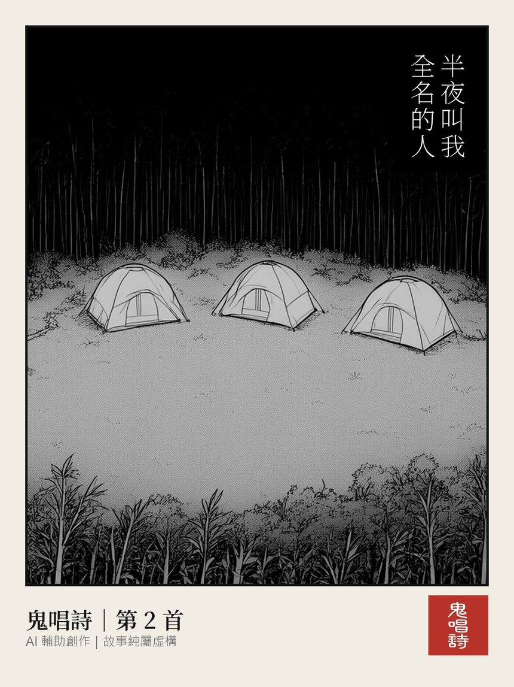
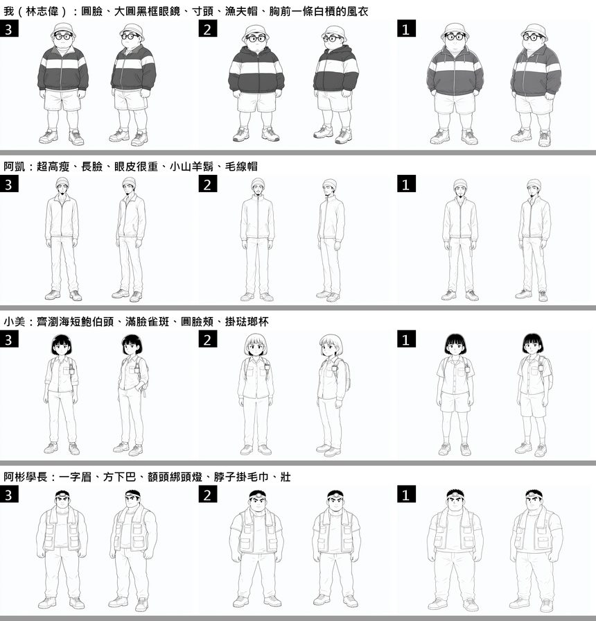
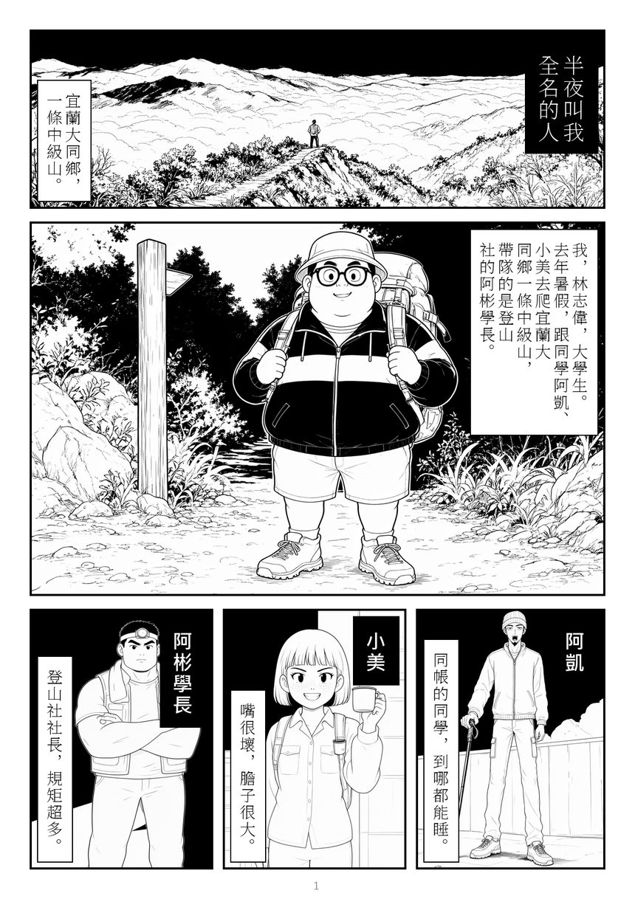
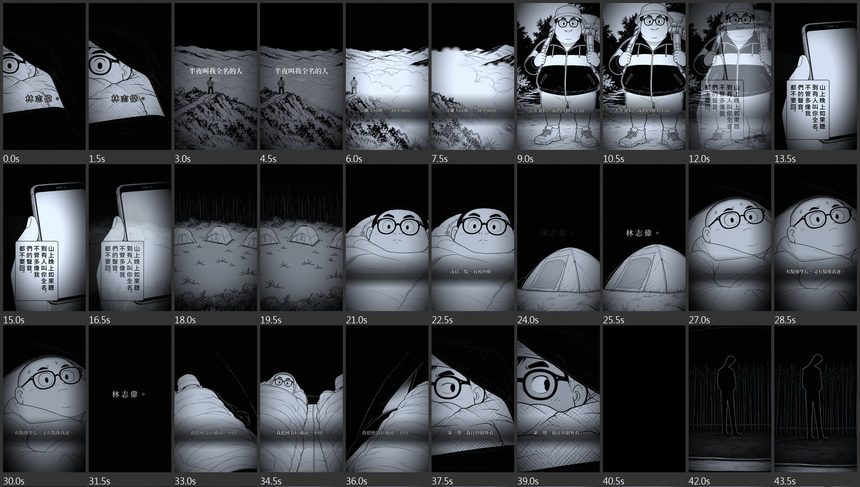

# 【AI 創作日記】鬼唱詩：AI 寫鬼故事、畫成漫畫、再剪成 Reel

台灣人好像都有幾個從小聽到大的鬼故事，
PTT 的飄板（marvel）上，也一直有人在寫自己的「經驗文」。

最近我做了一件以前想都不敢想的事：
**讓 AI 寫鬼故事、畫成漫畫、再剪成短影片**，
開了一個帳號，叫 **鬼唱詩**。

每一篇都標明「**AI 輔助創作｜故事純屬虛構**」。

---

## 一、整條流水線長這樣

我把它拆成五個步驟，每一步是一個獨立的 AI 技能（skill）：

1. **寫故事**：寫一篇飄板風格的鬼故事
2. **畫漫畫**：畫成黑白漫畫，由右往左讀
3. **做影片**：把整部漫畫剪成一支直式 Reel
4. **包裝**：拿編號（第 N 首）、寫各平台的文案
5. **發文**：檢查素材，發到 IG、Threads、Pinterest、YouTube Shorts、TikTok、FB

前三步做出來的東西都**不帶編號**，可以先做好放庫存，
決定哪天發的時候，才拿號、蓋號。
這樣發文順序可以隨時換，不用重做圖。

這其實就是我很習慣的工程做法：
先畫流程、定好每一步的輸入和輸出，
前一步寫到哪個資料夾、後一步從哪裡讀，全部寫成約定。

---

## 二、故事：不是靠感覺，是靠資料

「AI 寫鬼故事」聽起來很簡單，
但隨便叫 AI 寫，通常會寫出一篇很工整、很無聊的故事。

所以我先做了一件事：
把 **9,395 篇** 飄板文章標註起來，
統計推文最多的那些文章長什麼樣子——
發生在哪裡（宿舍、當兵、醫院夜班……）、
恐怖的機制是什麼（附身、事後才知道、不是本人……）、
結局怎麼收、鬼露臉露多少、篇幅多長。

整理出來的表裡，有 550 個改寫過的題材和細節類型，
**沒有收任何原文、標題和作者**。

寫的時候，先從表裡抽一副「骨架」，
AI 照骨架寫，寫完自己檢查、修改。
而且一次寫三篇，**三篇不同的骨架**，
再讓另一個 AI 在不知道哪篇是哪篇的情況下兩兩比較，
只留下最好的那一篇。

---

## 三、漫畫：三道關卡，我自己拍板

故事定了，才開始畫。

這是我學到的第一課：
有一次故事還沒給我看，就直接畫完了七頁，
結果我讀完覺得故事不好，整部丟掉——
**大約 104 分鐘的 GPU 時間就這樣沒了** orz

所以現在的規定是：**故事先給我看，我點頭才畫。**

畫之前還有三道關卡，都要我自己選：

1. **畫風**：先給我看三種
2. **角色和場景設定**：每個角色畫三個版本

3. **每一頁的分鏡草圖**

為什麼角色要先定?
因為漫畫最怕同一個人每一格長得不一樣。
所以每個角色都要有至少兩個好認的特徵（像是大圓黑框眼鏡、額頭綁頭燈），
每一格的提示詞都要寫進去。

圖是用 Qwen Image 2.1，在我自己的電腦上跑（一張 RTX 3090）。
**AI 只畫圖，不寫字**——
漫畫裡的每個字，都是程式排上去的，直書、由右往左。

一格有參考圖的畫面要 47 到 115 秒，每格畫 2 到 3 張挑一張。
一部漫畫下來，大約 **71 到 178 分鐘** 的 GPU 時間，
看篇幅和改了幾輪。

每一格畫完，還有另一個 AI 當檢查員挑毛病：
角色的眼鏡、帽子、衣服上的條紋有沒有畫對，同一件道具在前後格子裡是不是長得一樣。
最後再找一個「什麼都不知道」的 AI，只給它看完成的頁面，
問它看不看得懂、哪裡會卡住。

---

## 四、Reel：讓漫畫動起來

IG、TikTok、YouTube Shorts 都是短影片的天下，
所以最後一步，是把整部漫畫剪成一支直式影片：

- 開頭先放前半段最詭異的一刻，加一句兩拍的鉤子
- 有些格會用 AI 影片模型（MiniMax H3，一樣在自己電腦上跑）做成會動的片段，其他格加上鏡頭推移
- 字幕用故事裡的原話
- 揭露那一刻：黑畫面、音效、畫面一震
- 配樂和音效混到 -14 LUFS（短影片平台的常見音量）

第 2 首〈半夜叫我全名的人〉的影片大約 81 秒。

第 1 首〈阿嬤說我後面跟了三個人〉比較長，
一開始硬壓到 85 秒，旁白都被剪掉，
我看了覺得太趕、沒有漫畫順。
後來決定：**長故事就拆成上下集**，上集停在揭露前最強的那一刻，寫「下集待續」。

---

## 五、真的嗎?AI 做的東西有人要看嗎?

老實說，我也不知道。

目前發了 3 首，
每一首都發到 IG 輪播、Threads、Pinterest，
影片再發到 IG Reels、YouTube Shorts、TikTok 和 FB。

我比較確定的是兩件事：

**1. AI 讓「一個人做完一整條產線」變得可能。**
寫故事、畫漫畫、剪影片、寫文案，
以前是一個小團隊的事。

**2. 但「好不好看」還是要人來判斷。**
故事好不好、角色像不像、節奏順不順，
到現在都還是我一個關卡一個關卡在拍板。
AI 很會做，但它不知道什麼時候該丟掉重來。

---

如果你也喜歡台灣怪談，
歡迎來看看（記得收驚）：

👉 **[鬼唱詩 on Instagram](https://www.instagram.com/gui.chang.shi/)**

小弟第一次做漫畫和影片，
有什麼建議都歡迎告訴我 :)

\#鬼唱詩 #AI輔助創作 #看完記得收驚
