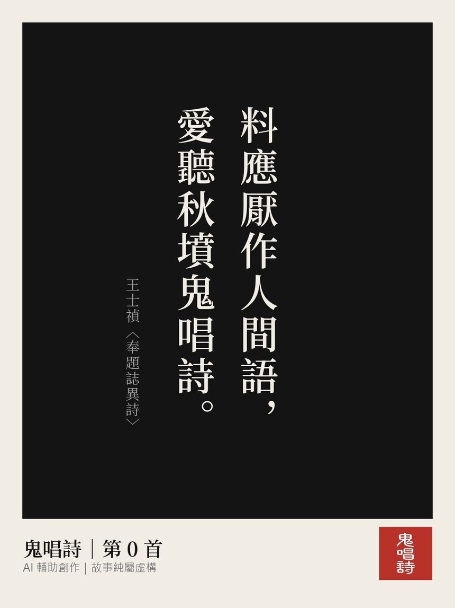
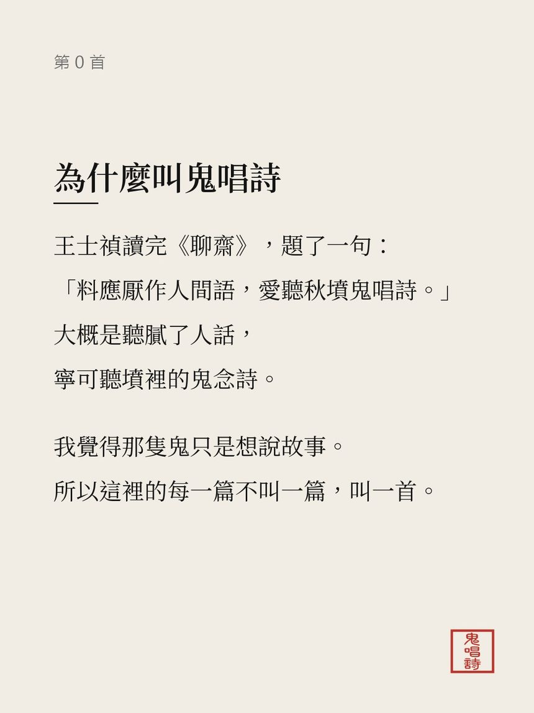
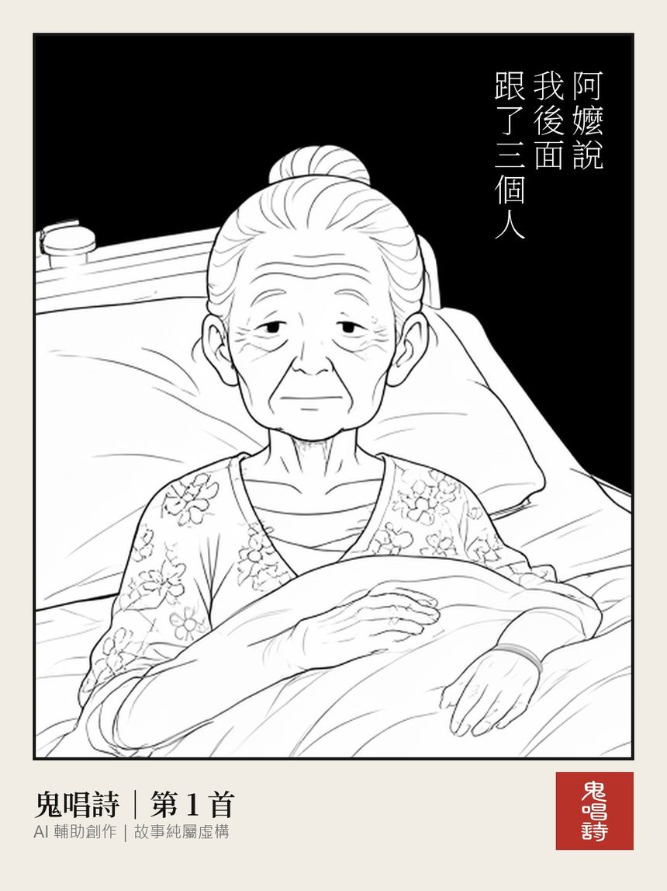

# 【鬼唱詩】為什麼是鬼故事?為什麼叫鬼唱詩?

上一篇寫了鬼唱詩是怎麼做的：
AI 寫故事、畫成漫畫、剪成 Reel。

這篇想聊兩個比較私人的問題：
**為什麼是鬼故事?**
**為什麼叫「鬼唱詩」?**

---

## 一、為什麼是鬼故事?

答案很簡單：
**因為從小看《鬼話連篇》之後，我就一直又愛看、又怕。**

年紀跟我差不多的台灣人，應該都有印象。
《鬼話連篇》是《玫瑰之夜》裡的靈異單元，
1991 年開始，由澎恰恰和曾慶瑜主持，一做就是七年。
藝人上節目講自己撞鬼的經驗，
觀眾寄來「靈異照片」，
一位從攝影的角度、一位從靈異的角度，一張一張分析。

中央社有一篇報導說，這個單元可以算是台灣靈異節目的始祖，
後來《猛鬼探險隊》《陰間旅行團》一個接一個，
到 90 年代末，同時有十個左右的靈異節目在播（[中央社](https://www.cna.com.tw/culture/article/20180803w001)）。

又愛看又怕，大概是鬼故事最奇妙的地方。
明明知道看完會不敢關燈，
還是會想：**再一個就好。**

我覺得，那種「怕」其實很安全——
你知道自己坐在家裡，什麼事都不會發生。
但知道歸知道，
半夜聽到有人叫我的名字，我還是不會回 XD

---

## 二、為什麼叫鬼唱詩?

鬼唱詩這個名字，出自一句詩：

> 料應厭作人間語，愛聽秋墳鬼唱詩。

這是清朝的王士禎，讀完蒲松齡的《聊齋誌異》之後題的詩。
意思大概是：**蒲松齡大概是聽膩了人話，寧可去聽秋天墳裡的鬼念詩。**
「秋墳鬼唱」又是從唐朝李賀〈秋來〉那句「秋墳鬼唱鮑家詩」化用來的。

我很喜歡這個畫面。
那隻鬼不是要嚇人，
它只是想說一個故事。

所以在鬼唱詩，
每一篇故事不叫「一篇」，叫「**一首**」：
第 1 首、第 2 首、第 3 首……

（順便澄清：是鬼唱詩，不是唱詩班 :p）

---

## 三、鬼唱詩的幾個規矩

- **全部是創作**：AI 輔助、一格一格有人檢查，故事純屬虛構。不是我經歷的，也不是你朋友的朋友經歷的。
- **只說台灣**：宿舍、大夜班、山路、超商、老家。
- **不點名真實地點**：只寫到縣市和「某區域醫院」，也不搬別人的故事。
- **鬼不會露太多**：露太多就不可怕了。
- **看完記得收驚。**

---

## 四、來聽鬼唱詩

如果你也是又愛看又怕的那種人，
歡迎來聽聽看：

- 漫畫：👉 **[Instagram @gui.chang.shi](https://www.instagram.com/gui.chang.shi/)**
- 文字版：[Threads @gui.chang.shi](https://www.threads.com/@gui.chang.shi)
- 影片：[YouTube](https://www.youtube.com/@%E9%AC%BC%E5%94%B1%E8%A9%A9)、[TikTok](https://www.tiktok.com/@guichangshi)、[Facebook](https://www.facebook.com/gui.chang.shi)
- 圖：[Pinterest](https://www.pinterest.com/guichangshi/)

傳給那個說自己不怕的朋友吧。

\#鬼唱詩 #台灣怪談 #又愛看又怕 #看完記得收驚
