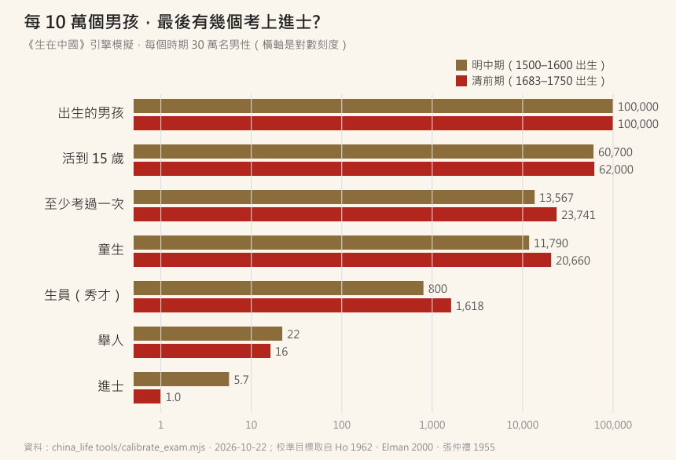
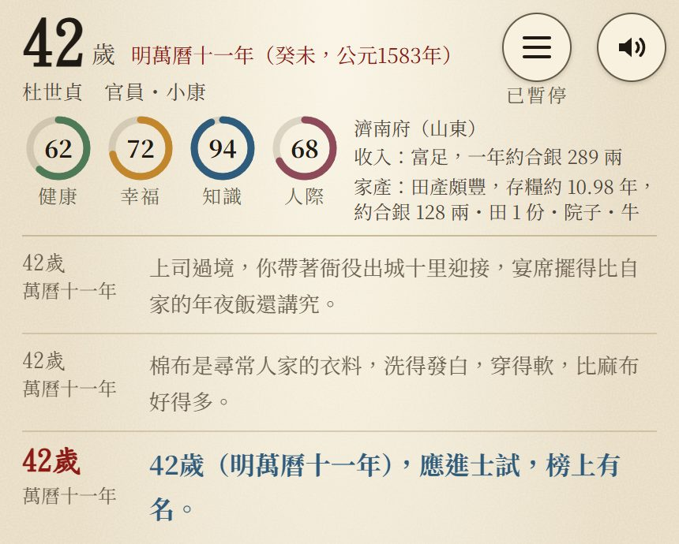
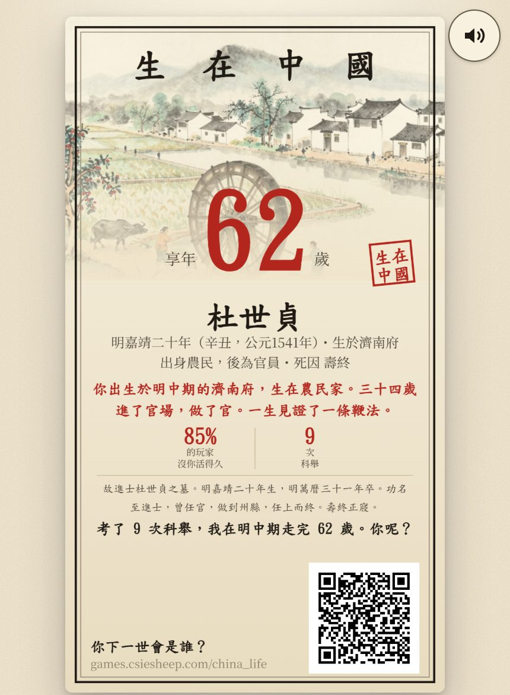

# 【生在中國】古代考上進士有多難?我模擬了 60 萬個男孩

很多人應該都記得國文課本裡的〈范進中舉〉：
一個考了大半輩子的讀書人，
聽到自己中了舉人，竟然高興到瘋掉。

以前讀到只覺得好笑。
直到做了《生在中國》，
用遊戲跑了幾十萬個人生，
我才真的懂了：**那是幾萬分之一的機會啊。**

---

## 一、先搞懂：進士要過幾關?

明清的科舉，大概是這樣一層一層往上爬：

1. **童試**：縣、府、院三關，考過了才是「生員」，就是俗稱的秀才
2. **鄉試**：三年一次，在省城考，考上叫「舉人」
3. **會試、殿試**：三年一次，在京城考，考上才是「進士」

每一關的錄取率大概是多少?
遊戲的資料表是這樣整理的（主要根據 Benjamin Elman、何炳棣、張仲禮的研究）：

- 童試 → 生員：大約 **1–3%**
- 鄉試 → 舉人：明代大約 **2–4%**，清代大約 **1–2%**
- 會試 → 進士：大約 **5–9%**

而一整個朝代，能出多少進士?
明代 89 科，總共大約 **2 萬 5 千名**，平均一科 279 人；
清代 112 科，大約 **2 萬 7 千名**，平均一科 240 人。

清朝中後期人口有三、四億，
一科卻只取兩、三百人。

---

## 二、真的嗎?用遊戲跑跑看

光看錄取率還不夠直覺，
因為每一關的分母都不一樣。

所以我用《生在中國》的引擎，
分別模擬了 **明中期** 和 **清前期** 各 30 萬個男孩，
看看最後有幾個人走到最上面：

用清前期來說，每 10 萬個出生的男孩：

- 活到 15 歲的，大約 **6 萬 2 千** 個（另外將近四成，早就夭折了）
- 至少進過一次考場的，大約 **2 萬 4 千** 個
- 考上生員（秀才）的，大約 **1,600** 個
- 考上舉人的，大約 **16** 個
- 考上進士的：**1 個**

**十萬個男孩，一個進士。**

資料表裡引的學界估計也差不多是這個量級：
以成年男性來算，一生考上進士的機率，大約是十萬分之一到二。

明中期稍微好一點，每 10 萬人大約 5 到 6 個。
但也就是「好一點」而已。

---

## 三、遊戲裡的一個進士：考了 9 次

在幾十萬個人生裡，我挑了一個考上的人。

他叫**杜世貞**，明嘉靖二十年（1541 年）生在濟南府，
家裡是**農民**，家境小康。

- 15 歲，家裡決定讓他讀書
- 21 歲，考過童生
- 24 歲，考上生員
- 33 歲，鄉試中了舉人
- 36 歲，進士落榜
- 39 歲，又落榜
- **42 歲，終於榜上有名**

從 15 歲讀到 42 歲，
**一共進了 9 次考場，花了 27 年。**
最後做到州縣的官，62 歲壽終。

想自己看他的一生，可以點這個連結重現：
👉 [杜世貞的一生](https://games.csiesheep.com/china_life/?seed=63198&period=ming_mid&sex=M&cv=v13)

而他已經是幾十萬人裡運氣最好的那幾個了。
大部分讀書的人，一輩子停在童生、停在秀才，
考到四十五歲，還是個「老童生」。

---

## 四、那讀書划算嗎?

這讓我想到以前寫過的〈概率權〉：
面對一個機率很小、但報酬很大的選擇，
期望值算出來或許不差，
但你要問自己：**最壞的情況，我扛得住嗎?**

讀書應考，就是這樣的賭注：

- 要有人供你吃飯、買書、請先生，家裡少了一個種田的勞力
- 一考就是二三十年
- 絕大多數人，最後什麼都沒考到

所以遊戲裡，家境越好、出身士人家的孩子，越可能去讀書。
這不是遊戲在偏心，是那個時代真的就是這樣。

但有一件事很有意思。
何炳棣在《明清社會史論》裡統計過：
**明代的進士，大約有一半出身三代內都沒有功名的家庭**；
到了清代，這個比例降到大約三成七（[沈登苗的整理](https://www.aisixiang.com/data/118091.html)）。
也有學者（像 Elman）認為這個數字高估了，
因為很多「平民」家庭，其實有當官的親戚幫忙。

不管哪一種說法，
科舉都沒有大家想像的那麼「公平」，
但也確實給了像杜世貞這樣的農家子弟，一條很窄很窄的路。

---

## 五、誠實講一下模擬的限制

- 每一次考試的「通過率」是我為了讓總量對上史料而**校準**出來的，不是直接照抄錄取率。
- 明代的生員在模擬裡**偏多**（每 10 萬大約 800 個，設計目標是 200 到 600），這部分還要再調。
- 功名只有「一關一關考上去」和「花錢捐納」兩條路；各省名額不同、恩貢這類特殊管道都沒有算進去。

有錯請指正 :)

---

如果你也想試試看，自己生在明清，能不能考上進士：

👉 **[生在中國](https://games.csiesheep.com/china_life/)**

（先說好，十萬分之一喔 XD）

\#生在中國 #十萬分之一 #老童生orz
