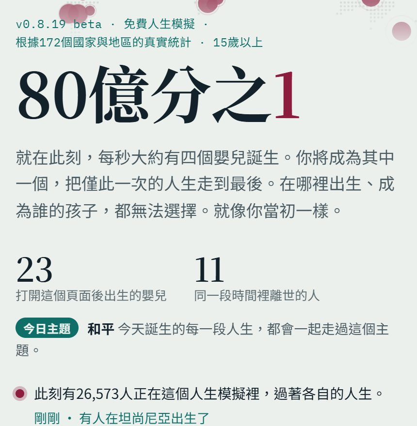
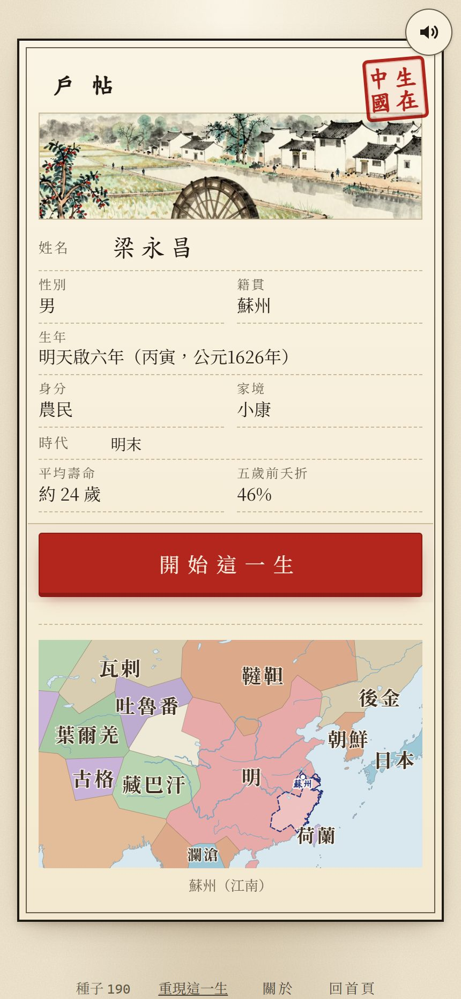

# 【遊戲開發日記】《80億分之1》：一個人、一個晚上、一個 AI，帶起一波「投胎模擬」

這個十月，
你的 Threads、FB 動態，
應該都被同一種截圖洗過版：

「出生台灣是 SSR 級首抽?」
「開局 1 歲肺炎夭折。」
「玩到眼眶紅。」

（這三句都是這幾週新聞的標題 XD）

它們都來自同一個網頁遊戲：**《80億分之1》（1 in 8 Billion）**。

---

## 一、它在做什麼?

規則只有一句：
**地球上每秒大約有四個嬰兒出生，你隨機變成其中一個，把這一生走完。**

你不能選國家、不能選爸媽、不能選家境。
出生在哪裡，是照真實的出生人數抽的。

網站首頁就把機率列給你看：
用聯合國《世界人口展望 2024》裡 2023 年出生的 1 億 3,193 萬個嬰兒來算，
生在印度的機率是 17.6%，中國 6.7%，奈及利亞 5.7%……

那生在台灣呢?
內政部的資料，2023 年台灣出生 13 萬 5,571 人，
算下來大約 **0.1%，差不多千分之一**。

所以「生在台灣是 SSR」這句話，
還真的不是在開玩笑 XD

接下來一年一格地活下去：
上學、工作、結婚、生病，
壽命、嬰兒死亡率、收入、受教育年數，
都照那個國家的真實統計（聯合國、WHO、世界銀行）在走。

---

## 二、它怎麼紅起來的?

我覺得這個故事本身，比遊戲還精彩。

根據日本一篇整理（[ギガビット的 note](https://note.com/gigabit_million/n/n04dc57f0e2d0)）：

- **10 月 5 日**，一位韓國的獨立開發者對 AI 下了一個指令，大意是：「從地球 80 億人裡隨機出生一個人，盡可能照真實統計模擬他的一生。」
- **大約 4 個小時**，做好、上線。
- 他本來沒打算正式發佈，只在當天晚上把製作過程貼到 Threads。
- 結果反應大到他**趕快去買了網域**。

之後從 Threads 傳到 X、KakaoTalk，再傳到日本和台灣。
10 月中旬加了繁體中文（[聯合報](https://udn.com/news/story/120911/9820367)），台灣就整個燒起來了。

我寫這篇的時候，首頁顯示：
**「此刻有 26,573 人正在這個人生模擬裡，過著各自的人生。」**
版本已經到 v0.8.19，支援 13 種語言。

遊戲本身免費，玩完可以付 90 元買「珍藏通行證」，把人生存成相簿。
沒有廣告，也不用註冊。

---

## 三、真的嗎?一個晚上做出來的東西，裡面有什麼?

身為工程師，我當然忍不住打開來看 :p

我在 10 月 16 日把它拆開來看了一遍（當時是 v0.7.31）：

- 整個遊戲就是**一個 3.2 MB 的網頁**，沒有框架
- 172 個國家，每個國家 34 個欄位（人口、壽命、嬰兒死亡率、收入、宗教、識字率……）
- 160 條歷史事件、214 條隨機事件、178 種人生抉擇
- 名字池涵蓋 95 種語言
- 後端只是二十幾個小小的 API，負責分享、追思館這些功能

4 個小時是初版。
真正讓它好玩的，是之後每天根據玩家回報一條一條修：
有人回報「我明明有車，卻出了機車車禍」，開發者就去改。

所以我覺得，AI 給的是**起點的速度**，
但讓人想一直玩下去的，還是那個願意一條一條修的人。

---

## 四、為什麼說它帶起一波浪潮?

「人生模擬」不是新東西。
手機上的《BitLife》2018 年就有了，玩法也是從出生活到死。

但《80億分之1》有兩個不一樣的地方：

1. **它用的是真實的統計**，所以玩家看到的不是劇情，是「另一個我」可能真的會遇到的人生。
2. **它證明了一個人加上 AI，一個晚上就能做出全世界都在玩的東西。**

第二點，我覺得才是真正的浪潮。

我自己就是被帶動的那一個。
10 月 16 日，我把它拆開來看完，
當天就開工做了一個「時間版」：
**不是生在哪個國家，而是生在中國歷史的哪一年。**

這就是《生在中國》，
出生年從戰國到 1940 年，分成 35 個時期，
平均壽命、夭折率、科舉錄取率、饑荒和戰亂，也都照史料和學界估計在走。
（做的過程我寫在[這篇](https://csiesheep.com/?p=800)，夭折率和進士的模擬寫在[這篇](https://csiesheep.com/?p=840)和[這篇](https://csiesheep.com/?p=856)。）

我也看到網路上出現了其他類似的網站，
有的連名字都很像（例如 1in8b.dev，作者沒有說明和原站的關係）。

我猜接下來會有更多「80 億分之一」的變體：
不同的國家、不同的時代、甚至不同的物種。
當一個點子被所有人看到，
最好玩的，往往是大家各自把它改成自己最在乎的樣子。

---

## 五、玩完之後

很多人玩完的心得都很像：
「原來我能平安長大，已經很幸運了。」

我覺得這就是這類遊戲最厲害的地方。
它沒有講任何大道理，
只是讓你用 5 分鐘，活一次別人的人生。

如果你還沒玩過：

👉 [80億分之1](https://1in8b.life/zh/)

如果你好奇自己生在中國古代會怎樣：

👉 [生在中國](https://games.csiesheep.com/china_life/)

有錯請指正 :)

\#80億分之1 #生在台灣是SSR #千分之一
