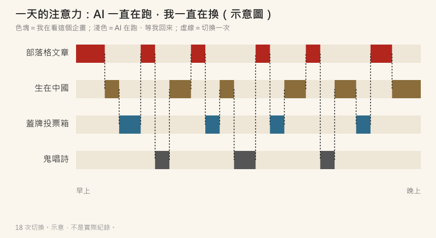

# 【AI 心得】用了 AI，我沒有變輕鬆

大家都說 AI 會讓工作變輕鬆。

真的嗎?

我用 AI 用得很兇，
結論是：**沒有變輕鬆，反而更累。**

而且我發現，不是只有我這樣——
我有個同事，現在每天都要打坐一個半小時 XD

---

## 一、為什麼沒有變輕鬆?

因為 AI 太強了。

以前一個人，一次只能認真做一件事。
現在有 AI，每一件事都「好像」可以做，
於是我就開了很多個企畫。

看看我這幾天在做什麼（10 月 20 日到 23 日）：

- 部落格寫了 **7 篇**新文章，另外替 **32 篇**舊文補寫內容
- 《生在中國》修 bug、驗證、部署
- 《蓋牌投票箱》從第一個 commit 到上線，**一天**
- 鬼唱詩的漫畫和短影片

四件事，同時在跑。

這其實有個名字，叫 **Jevons 悖論**：
1865 年，經濟學家 Jevons 發現蒸汽機越省煤，英國用的煤反而越多。
因為「做一件事變便宜了」，大家就會去做更多事。

AI 讓做企畫變便宜了，
所以我就做了更多企畫。
省下來的時間，一分鐘都沒有留給自己 orz

---

## 二、AI 每一步都要等

問題是，AI 不是按一下就好。

它每一步都要時間：

- 叫 AI 寫一篇文章的補記，等兩到五分鐘
- 叫 AI 修一個 bug，等十分鐘
- 叫 AI 把整套測試跑一遍、再故意弄壞看會不會抓到，**等了兩個多小時**
- 畫一部漫畫，GPU 要跑一到三個小時

等的時間，又不能完全不管：
它可能做到一半有問題要問我，
做完了我也要看結果、決定下一步。

所以我的一天變成這樣：

A 企畫交給 AI → 切到 B → B 也在等 → 切到 C →
A 好了 → 回到 A → 「我剛剛做到哪裡?」……

**AI 一直在跑，我一直在換。**

---

## 三、真的嗎?切換真的那麼傷?

我去查了一下，還真的有研究。

- 2001 年，密西根大學的 Meyer 等人做了實驗：每次在兩件事之間切換，都會浪費時間，事情越複雜、越不熟，浪費越多。Meyer 估計，這種切換的卡頓，最多可能吃掉 **40% 的生產時間**（[APA](https://www.apa.org/topics/research/multitasking)）。
- 2009 年，Sophie Leroy 提出「**注意力殘留**」（attention residue）：你從 A 切到 B，腦袋還有一部分留在 A。A 越沒做完，殘留越多。
- UC Irvine 的 Gloria Mark 研究辦公室工作：被打斷之後，平均要 **20 幾分鐘**才回到原本的事情。

我很愛的《Peopleware》也講過：
工程師要進入心流，至少要 15 分鐘以上的專注。
被打斷一次，就要重新來過。

以前打斷我的，是會議和訊息。
現在打斷我的，是**我自己開的那四個 AI**。

而 AI 最大的特色，就是它永遠在等你回來。
它不會累、不會煩、不會說「你先忙」。
所以每一個在等的 AI，
都像是一個在你腦袋裡舉手的小人。

難怪我同事要打坐一個半小時。
我覺得那不是在放空，
是在把一整天的「殘留」清掉。

---

## 四、那怎麼辦?

我還在找答案，先列幾個我正在試的方法：

**1. 少開幾個企畫。**
聽起來很廢話，但這是根本。
看板方法（Kanban）有一條規則：**限制同時在做的事情數量**。
同時做的事情越多，每一件做完的時間就越長——這在排隊理論裡叫 Little's Law。
AI 讓我「開得起」更多企畫，不代表我「顧得起」。

**2. 讓 AI 留下紀錄，而不是叫我回來。**
我做遊戲時學到一招：
叫 AI 把進度寫在 issue、寫在檔案裡，而不是做完叫我。
我回到某個企畫時，看紀錄就知道做到哪裡，
不用靠腦袋記，殘留就少很多。

**3. 一次看完一批，不要一個一個看。**
與其每個 AI 好了就切過去，
不如固定時間，一次把所有好了的結果看完。
像上面那張圖，18 次切換，或許可以變成 4 次。

**4. 等的時候，不要再開新的。**
這條我最做不到 XD
看到 AI 在跑，手就癢，想說「那我順便開一個……」
然後就變成五個了。

---

## 寫在最後

我以前寫過一句：
「最大的風險來自無知，要減少風險就是要減少不確定的因素。」（〈如何減少寫程式的風險〉）

AI 讓「做」變得很便宜，
但「想」還是很貴。
每一次切換，都是在付想的錢。

也許用 AI 真正要學的，
不是怎麼叫它做更多，
而是**決定不叫它做什麼**。

我先去打坐了（並沒有）。

\#用了AI沒有變輕鬆 #腦袋裡有四個小人在舉手 #打坐一個半小時
