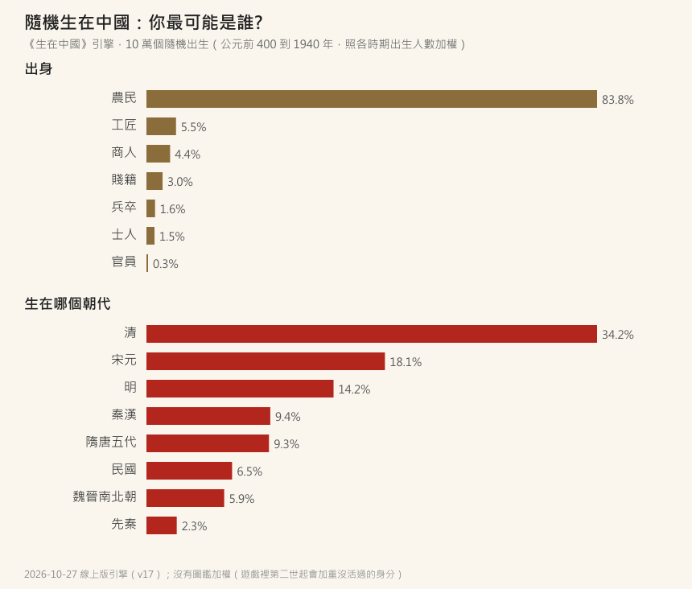
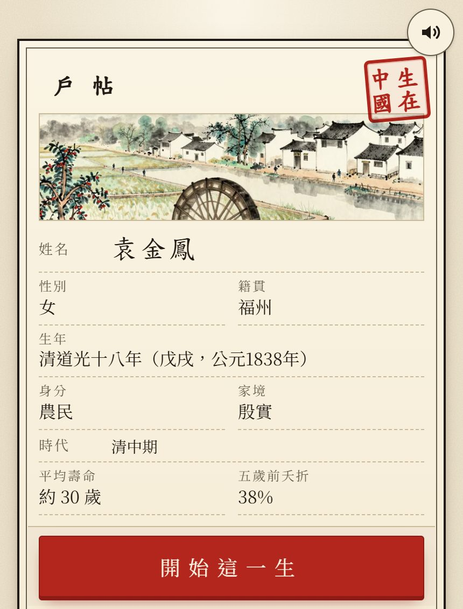

# 【生在中國】如果你投胎到中國古代，你最可能是誰?

穿越劇的主角，
不是皇子，就是公主，
再不然也是宰相家的千金。

但如果真的把你隨機丟回中國古代，
你最可能是誰?

我用《生在中國》的引擎，
從公元前 400 年到 1940 年，
**隨機投胎了 10 萬次**，
照每個時期真實的出生人數加權——人越多的時代，越容易抽到。

結果是這樣：

---

## 一、你十之八九是農民

10 萬次投胎裡：

- **農民 83.8%**
- 工匠 5.5%、商人 4.4%
- 賤籍（奴婢、樂戶、差役這類）3.0%
- 兵卒 1.6%
- **士人 1.5%**
- **官員 0.3%**

也就是說，你想像中那種讀書人、官家子弟，
加起來不到 2%。
**一百個人裡，有八十多個在種田。**

那這輩子能不能翻身?
一生中換過身分的，只有 **0.85%**。
最後當上官的，0.33%——比出生就在官家的人只多一點點。

想靠讀書翻身的話：
考過童生的 3.1%，考上秀才（生員）的只有 0.24%，
**舉人在 10 萬人裡一個都沒有。**
（進士有多難，我在[之前那篇](https://csiesheep.com/?p=856)算過：大約十萬分之一。）

---

## 二、你最可能生在清朝

朝代的分佈也很懸殊：

- **清朝 34.2%**，三個人裡就有一個
- 宋元 18.1%、明 14.2%
- 秦漢 9.4%、隋唐五代 9.3%
- 先秦只有 2.3%

為什麼清朝這麼多?
因為清朝中後期人口有三、四億，是明朝最多時的兩倍以上。
光是「清中期」（1800 到 1850 年）這 50 年，就占了 8.9%。

那秦朝呢?
只有 **0.22%**。
秦朝本身才 15 年，人口也少。
**生在清朝的機率，大約是生在秦朝的 150 倍。**

所以穿越劇最愛的秦皇漢武、大唐盛世，
真的要抽到，運氣要很好 XD

---

## 三、你大概一輩子沒離開過家鄉

這是最讓我意外的一個數字：

**97% 的人，一輩子沒有離開出生的那一區。**

遊戲把中國分成十大區（江南、中原、荊湖、山東……），
就算只算活過 15 歲的大人，也有 95% 從生到死都在同一區。
會搬家，多半是因為饑荒逃荒、戰亂，或是進城謀生。

順便一提，最可能出生的地區是**江南（17.5%）**，其次是中原、荊湖、山東。

---

## 四、你可能活不長

再補幾個數字：

- **34%** 活不過五歲（這部分我在[這篇](https://csiesheep.com/?p=840)仔細寫過）
- 活到 60 歲的，**不到兩成**
- 活到 80 歲的，2.4%
- 一生遇過饑荒的 10.6%，遇過戰爭的 21%

把以上全部加起來，
「最典型的你」大概長這樣：

**袁金鳳**，清道光十八年（1838 年）生在福州的農家，
家境還算殷實。
那個時代，平均壽命大約 30 歲，五歲前夭折 38%。

不是公主，也不是千金，
就是一個清朝的農家女孩。
而這，就是兩千年裡最常見的人生。

---

## 五、誠實說一下

- 這是**引擎模擬**，不是史料。人口、身分比例、壽命都照資料表跑，越早的年代推估的成分越高。
- 地區只分十大區，身分只分七類，很多細節（民族、宗教）沒有納入。
- 如果你去遊戲裡的「眾生簿」看，玩家實際抽到的農民大約是 **七成**，比這裡低。
  因為遊戲從第二世起，會把**你還沒活過的身分**權重加 3 倍，讓大家比較有機會集滿圖鑑。
  這篇的 10 萬次投胎沒有這個加權，比較接近「真的隨機」。

---

所以，下次看穿越劇的時候，
可以想一下：
**真正的你，大概正在田裡插秧。**

想自己抽抽看：

👉 **[生在中國](https://games.csiesheep.com/china_life/)**

有錯請指正 :)

\#生在中國 #十之八九是農民 #生在清朝的機率是秦朝的150倍
