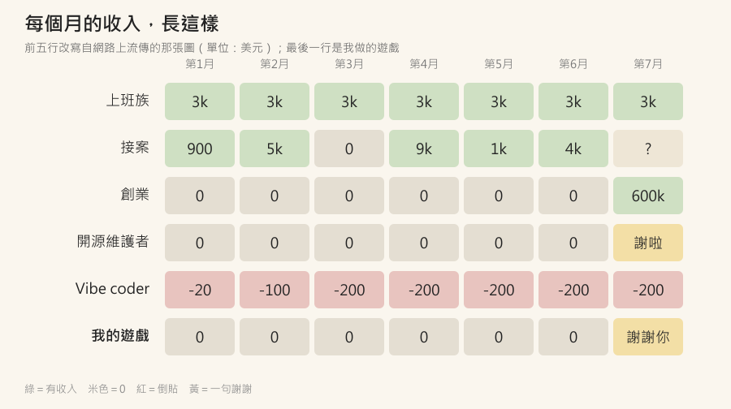

# 【遊戲開發日記】上班族、接案、創業、開源、Vibe coder：那張收入圖，真的太真實了

最近在網路上看到一張圖，
只有五行字，
我看完笑了很久，
然後笑不太出來。

大意是這樣：

- **上班族**：3k、3k、3k、3k、3k
- **接案**：900、5k、0、9k、1k、4k
- **創業**：0、0、0、0、0、0、600k
- **開源維護者**：0、0、0、0、0，「謝啦兄弟」
- **Vibe coder**：-20、-100、-200、-200

我重畫了一張，最後加了一行我自己的：

---

## 一、為什麼說太真實?

因為每一行，都是一種**風險的形狀**。

- 上班族是一條直線。不會暴富，也不會餓死。
- 接案是心電圖。平均可能比上班族高，但你不知道下個月是 9k 還是 0。
- 創業是彩券。前面全是 0，最後那一格可能是 600k，也可能根本沒有第七個月。
- 開源是公益。東西被很多人用，收入是一句謝謝。
- Vibe coder 是……**付錢上班**。

我以前寫過〈概率權〉：
確定拿 100 萬，跟 50% 機率拿 1 億，
我第一個反應是選 100 萬，
因為我**承受不了失去它的痛苦**，落袋為安。

所以，我是那條直線的人。

---

## 二、但我下班之後，是最後那一行

這兩個多月，我下班之後用 AI 做了 10 款網頁遊戲。

數字攤開來：

| 項目 | 數字 |
|---|---|
| 做了幾款遊戲 | 10 款 |
| 《生在中國》被玩了幾局 | 13,950 局（10/29） |
| 遊戲收入 | 0 |
| AI 訂閱費 | 每個月固定扣 |

為什麼收入是 0?

- 想放廣告，部落格的 AdSense 審核被判「**低價值內容**」，連遊戲網站也一起不能放。
- 也決定先不放打賞。

所以我現在的收入曲線，
就是 **Vibe coder 那一行，加上開源那一句謝謝。**

那句謝謝是真的有收到：
有一位我不認識的玩家，自己把《生在中國》貼上 4388 小遊戲，
一毛錢都沒拿（我在[上一篇](https://csiesheep.com/?p=872)寫過）。

---

## 三、真的嗎?那幹嘛還做?

這是一個好問題，我也問過自己。

照期望值算，Vibe coder 那一行是負的，
怎麼算都不划算。

但我後來想，
**也許我算錯了問題**。

如果問題是「這個月賺多少?」，那答案是負的。
如果問題是「我花錢買到了什麼?」，答案就不一樣：

1. **學到的東西**：怎麼讓 AI 分工、怎麼驗證它真的做完、怎麼推廣（推廣最難）。這些在上班的時候也用得到。
2. **一個最小的實驗**：以前想做一個產品，要先找人、找錢、花半年。現在一份 AI 訂閱，就能把點子做出來，丟給真的人玩，看數字說話。
3. **好玩**：13,950 局，有人一天玩二三十局，有人幫你上架。這種開心，薪水給不了。

而且，Vibe coder 能這樣玩，
**是因為上面還有那條直線撐著**。
上班族的 3k，在付 Vibe coder 的 -200。

這大概才是最真實的地方：
很多人不是在五行裡選一行，
而是**白天活在第一行，晚上活在最後一行**。

---

## 四、接下來

我不打算辭職去賭第七個月的 600k，
我扛不住 XD

比較實際的做法是：

- 先讓遊戲**值得被推薦**，再想怎麼收入。
- 把部落格的內容寫紮實，再送一次 AdSense 審核。
- 每個月看一次：花的錢、學到的東西、玩的人數，三個一起看，不只看收入。

如果哪天最後一行出現了一個正數，
我一定會回來更新這張圖。

在那之前，
謝謝每一位玩過的人，
你們就是那句「謝啦兄弟」:)

👉 [生在中國](https://games.csiesheep.com/china_life/)

有錯請指正。

\#上班族在養vibecoder #期望值是負的 #但是好玩 #thanksbro
