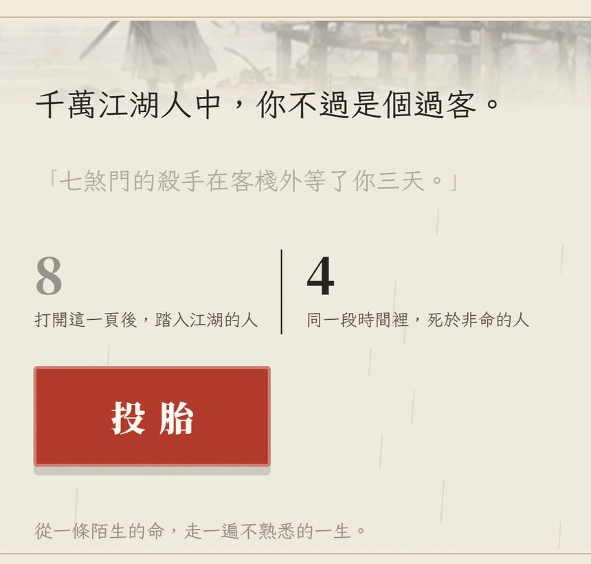
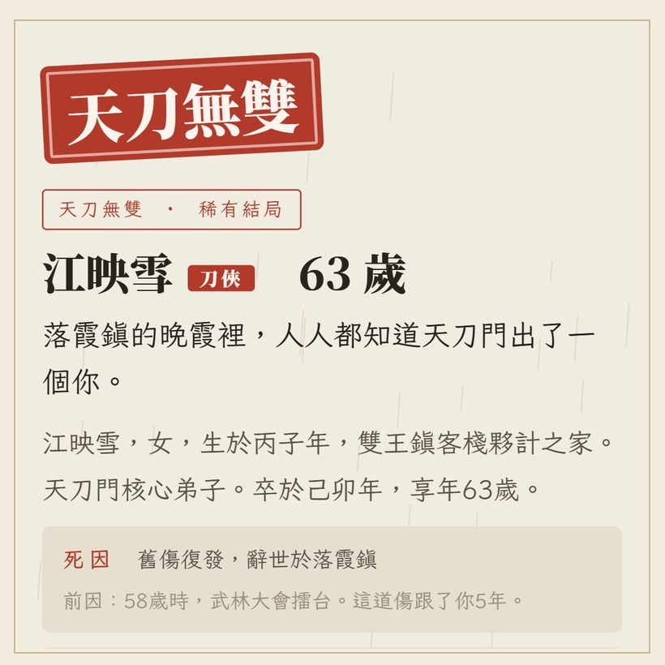
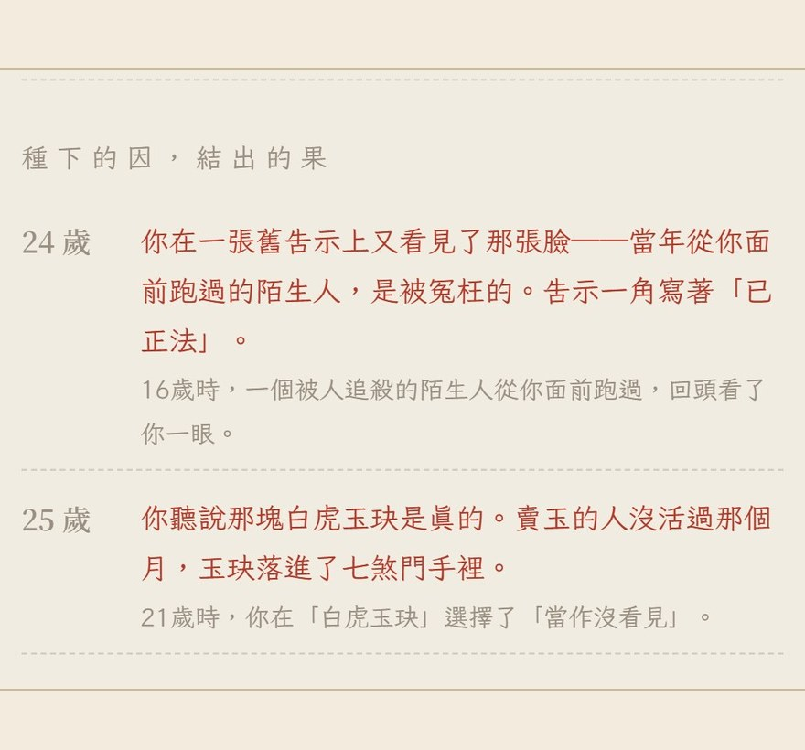

# 【熱門遊戲介紹】《江湖千萬人》：千萬江湖人中，你不過是個過客

看武俠小說，
大家想當的都是主角，
很少有人想當書裡那些連名字都沒有的人：
客棧的夥計、被滅門的那一家、擂台底下喊好的觀眾。

最近有一款網頁遊戲，
就是讓你**投胎成那些人**。

它叫《江湖千萬人》，
副標題只有一句：
**「千萬江湖人中，你不過是個過客。」**

---

## 一、它是什麼?

先把查到的事實列出來：

- **誰做的**：根據 Paradaily 10/21 的報導，是台灣遊戲人「飛鳥」，星宿科技（NovaStar Game）的總經理，在遊戲業做了十多年營運，參與過手遊《煙雨江湖》在台灣的發行。
- **怎麼做的**：用 Claude，**前後大約三天**。報導說這是他第一次做遊戲，也是第一次用 AI 做遊戲。
- **玩法**：致敬韓國的網頁遊戲《80億分之1》，隨機投胎、看完一生（這款我在[之前那篇](https://csiesheep.com/?p=858)介紹過）。
- **世界觀**：《煙雨江湖》的江湖。18 種出身、26 種「脈序」天賦，有「天生神力」，也有幾乎沒用的「味同雞肋」XD
- **結局**：官網說五十多種，我玩完在圖鑑看到是 57 種。
- 免費，不用下載、不用註冊，打開網頁就能玩。

三天。
我看到這個數字的時候，第一個反應是：**真的嗎?**
然後去玩了一局，大概懂了。

---

## 二、我抽到的一生：江映雪

我投胎在雙王鎮，客棧夥計家的女兒，叫**江映雪**。
家裡赤貧，出生那年大旱。

脈序抽到稀有的「梵我合一」，閃避過人、不容易受傷。
畫面還寫了一行：「同一刻，江湖上還有四個人出生。」

我偷懶，全部按「交給命運」，開 4 倍速，
一生大約 3 分鐘就跑完了。

她的一生大概是這樣：

- **6 歲**，選了讀書識字，替鎮上的人寫信，第一次有人叫她「先生」。
- **8 歲**，拜入天刀門，刀比手臂還長。
- **16 歲**，一個被追殺的陌生人從她面前跑過，回頭看了她一眼。她沒有動，也沒有出聲。
- **24 歲**，她在一張舊告示上又看到那張臉：那人是被冤枉的，告示一角寫著「已正法」。
- **53 歲**，崑崙山巔，朋友胡小刀替她擋了一劍，一身武功廢了。他說以後改行說書，頭一段就說崑崙山巔，有個人站在最前面。
- **58 歲**，少林武林大會，打進最後四人，**第三百招輸了半式**，受了一點輕傷。之後每逢陰雨天就痛：「你開始怕煙雨天。」
- **63 歲**，舊傷復發，走了。

結局頁寫：「前因：58歲時，武林大會擂台。這道傷跟了你5年。」

我看到這行，愣了一下。
**一個隨機事件，被寫成了一輩子的伏筆。**

---

## 三、它最厲害的地方：因果會回頭點名

做過這類遊戲的人都知道，
「隨機人生」最大的問題是：
**事件一個一個來，像在擲骰子，玩完不會記得。**

《江湖千萬人》的解法很簡單，也很聰明：
**每一個「果」，都寫出是哪一歲的哪一個「因」。**

16 歲看到的陌生人，24 歲在告示上回來；
58 歲的輕傷，63 歲回來收命。

骰子還是骰子，
但只要**回頭點名**，玩家就會覺得這一生是有劇本的。
這招我自己做遊戲的時候，真的想偷學。

另外兩個我很喜歡的設計：

1. **首頁自己在玩**。一打開，「踏入江湖的人」「死於非命的人」兩個數字就開始跳，旁邊的判詞一張一張換。我去看了一下程式，是引擎真的在你的瀏覽器裡跑人生。封面本身就是一局遊戲。
2. **主線來了會提醒你放慢**。開 4 倍速的人，跑到主線劇情時，它會問要不要改回 1 倍速慢慢看。快轉的人也不會錯過重點。

誠實講一個小缺點：
全部「交給命運」的話，我幾乎沒做什麼選擇，
4 倍速下好幾段劇情是飛過去的 orz
想要有參與感，主線跳出來時記得按「好」。

---

## 四、三天，是怎麼做到的?

我自己也是用 Claude 做遊戲的，所以特別好奇這個「三天」。

我的猜測（這是推斷，報導沒寫）：
**難的部分，他十幾年前就做完了。**

- 《煙雨江湖》的人物、門派、武學、江湖大事，都是現成的，而且他很熟。
- 玩法有《80億分之1》當範本，不用從零想。
- 他做了十幾年遊戲營運，知道玩家會在哪裡卡住、哪一句話會被分享。

AI 幫他省掉的，是寫程式那一段。
但**知道要做什麼**，是那十幾年給的。

這跟我在[〈一個人用 AI 做了 10 款網頁遊戲〉](https://csiesheep.com/?p=843)裡的心得一樣：
AI 讓「做出來」變快了，
但「做什麼」「做得好不好」，還是要靠人。

還有一件我覺得很聰明的事（這也是我從官網推的）：
它的「關於」寫明是《煙雨江湖》的全球發行商製作，頁尾有一個「進入煙雨江湖」的連結，隱私說明也寫了會用廣告工具。
也就是說，**這款遊戲本身，就是一張很好玩的名片**。
玩完一生還想多看看那個江湖的人，就有地方可以去。
用一款三天做的小遊戲，替一款營運多年的手遊找新玩家，我覺得這是一個很漂亮的實驗。

---

## 五、同一刻出生的四個人

最後講一個讓我笑出來的地方。

畫面上那句「同一刻，江湖上還有四個人出生」，
我們做的《生在中國》，結局頁也有「同年出生的四個人」。

我們是跟《80億分之1》學的，它有「同一秒出生的 4 人」。
《江湖千萬人》也致敬它，
**兩款台灣做的遊戲，跑去跟同一款韓國遊戲學了同一招**，撞在一起我一點都不意外 XD

跟江映雪同一刻出生的四個人裡，
一個 31 歲走火入魔，
一個當上了武林盟主，活到 76 歲，最後也是舊傷復發走的。

她那屆沒拿到盟主，
但畫面寫，台下很多人記住了她。

千萬江湖人中，她不過是個過客。
但有人記得，大概就夠了。

---

👉 [江湖千萬人](https://yanyu-life.novastargame.net/)：投胎到武俠的江湖
👉 [生在中國](https://games.csiesheep.com/china_life/)：投胎到真實的古代中國

你抽到什麼結局?
有錯請指正 :)

\#江湖千萬人 #煙雨江湖 #三天做一款遊戲 #難的是那十幾年 #同一刻出生的四個人
