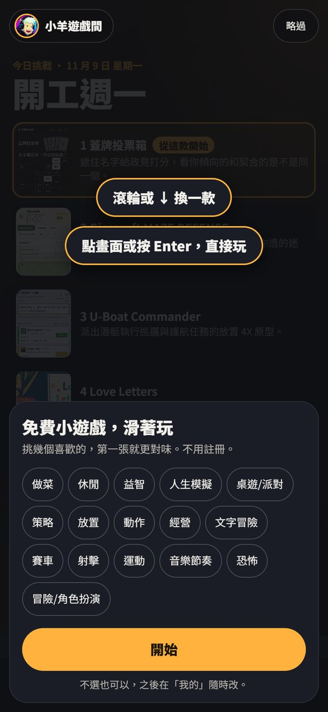
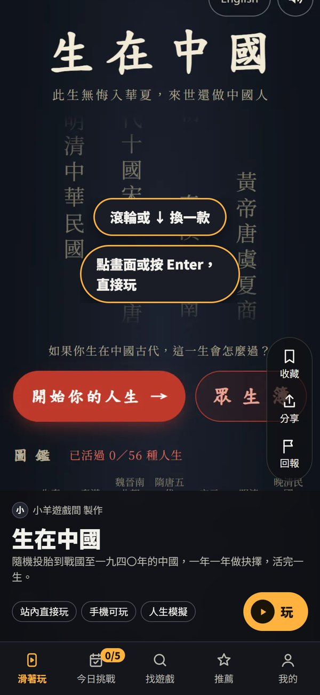
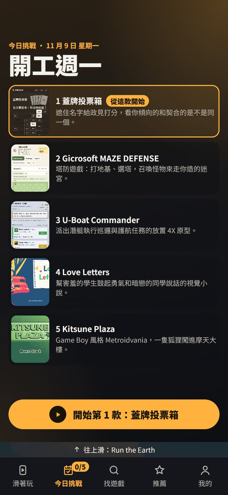
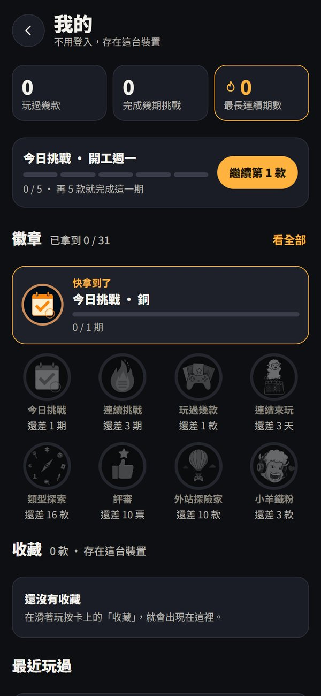

# 【遊戲開發日記】不知道玩什麼?滑滑滑：我們開了一個遊戲大廳「小羊遊戲間」

上一篇我寫到，
有一位不認識的玩家，把《生在中國》貼上了 4388 小遊戲，
我才發現：**做遊戲最難的不是做，是讓人找到**（[那篇在這](https://csiesheep.com/?p=872)）。

那時候我想了一個問題：
如果玩家找不到遊戲，
那**到底是誰的問題?**

---

## 一、真正的問題是什麼?

我以前寫過一本書的心得，《真正的問題是什麼?》，
裡面最有名的是電梯的故事：
大家抱怨電梯太慢，工程師想的是加電梯，
後來有人在電梯口擺了一面鏡子，抱怨就沒了。
**問題不是電梯慢，是等電梯很無聊。**

做遊戲的人想的問題是：「我的遊戲怎麼被看到?」
但換到玩家那一邊，問題其實是：
**「我現在有十分鐘，不知道要玩什麼。」**

網路上的小遊戲多到數不完，
光是 4388 就收了五千多款。
缺的不是遊戲，
是**一個打開就能玩、不喜歡就換下一款的地方**。

所以我們做了 **小羊遊戲間**：

👉 [games.csiesheep.com](https://games.csiesheep.com/)

---

## 二、它長什麼樣子?

一句話：
**不知道玩什麼?滑滑滑，不喜歡就滑下一款。**

第一次打開，它會問你喜歡哪些類型：
做菜、益智、人生模擬、桌遊、恐怖……一共 16 類。
不選也可以，直接開始。

然後就是一張一張的遊戲卡，
像滑短影片一樣往上滑。
看到有興趣的，點一下就玩。

現在上架的遊戲有 **1,513 款**：

| 從哪裡來 | 款數 |
|---|---|
| 4388 小遊戲的排行榜 | 1,419 |
| 在 Threads 上找到的網頁遊戲 | 90 |
| 我們自己做的 | 4 |

自己做的 4 款是《生在中國》、《蓋牌投票箱》、《天地會》、《骰子戰爭》，
這 4 款可以直接在站內玩；
其他的，按「玩」會開新分頁，**連到作者自己的網站**。

---

## 三、每天 5 款：今日挑戰

光是滑，很容易滑一滑就走了。
所以我們加了一個小儀式：**今日挑戰**。

每天挑 5 款，有一個主題，
例如我截圖的這天（11/9 星期一），主題是「開工週一」。

5 款都玩過，就完成今天的挑戰，
還可以產生一張成績卡分享給朋友。
連續幾天都完成，會累積成「連續期數」。

外站的遊戲沒辦法知道你有沒有真的玩，
所以規則是：**你玩完回來，回答一句「好不好玩」，才算完成。**

還有一個「我的」頁面，
有 31 枚徽章可以收集：玩過幾款、連續挑戰、類型探索、評審……

不用註冊、不用登入，
紀錄都存在你自己的這台手機或電腦裡。

---

## 四、幾個刻意「不做」的決定

做這個大廳的過程，
我覺得最重要的，反而是**決定不做什麼**：

1. **不放廣告，也不放打賞。**
   第一版頁面上沒有任何跟錢有關的入口。先讓它好玩、有人用，錢的事下一版再說。（我在[收入圖那篇](https://csiesheep.com/?p=874)寫過，現在的收入是 0，這點還是一樣 XD）
2. **不嵌入別人的遊戲。**
   別人的遊戲一律連到作者自己的網站。遊玩次數、廣告收入，都留在作者那邊。
3. **不寫「一局 3 分鐘」。**
   估計的時間常常不準。我們只顯示量出來的時間，不用猜的。
4. **不用登入、不開留言。**
   少一個門檻，就多一個人願意試試看。

另外，每一款遊戲上架前，
都會用手機和電腦**各開一次**，確認打得開、不用登入、不用付費、內容沒問題，
再由我在審核頁看過、按「上架」。
看不出來能不能玩的，先不放。

---

## 五、1,513 款是怎麼來的?

說穿了，就是很笨的方法：**一款一款看。**

- 先從 4388 的排行榜抓名單，**每 10 秒才開一頁**，不要給人家的網站添麻煩。前 1,000 名抓完，再抓 1,001 到 2,000 名。
- 再去 Threads 上找大家在分享的網頁遊戲，又找到一百多款。
- 每一款都開起來看：手機能不能玩、電腦能不能玩、要不要登入、要不要付錢、內容有沒有問題、屬於 16 類裡的哪一類。

數字大概是這樣：

| 批次 | 看了幾款 | 上架 |
|---|---|---|
| 開站那一批（4388 前 100 名＋自家） | 約 100 | 98 |
| 第一、二批（4388 前 1,000 名的其餘候選） | 900 | 597 |
| 第三批（4388 第 1,001–2,000 名＋Threads） | 1,117 | 817 |

被擋下來的，有些是打不開，
也有一些很妙的：加密貨幣宣傳、假裝成登入頁的網站、其實是商店頁、根本不是遊戲……
**光是「確認它真的是一個能玩的遊戲」，就是一門功夫。**

---

## 六、AI 幫了什麼?

這個大廳 10/29 開工，
10/31 就接手了 games.csiesheep.com 的首頁，
到現在 git 裡有 427 次 commit，還在一直改。

跟[之前做遊戲](https://csiesheep.com/?p=843)一樣，
寫程式、截圖、判斷每款遊戲能不能在手機上玩，大多是 AI 在做；
我做的是另一半：
**決定要什麼、不要什麼，然後一個一個看過。**

上面那四個「不做」，AI 會把選項列出來，
但最後都是我自己拍板的。
這大概也是我這兩個月最大的心得：
**AI 讓「做出來」變得很快，但「做什麼」還是要人來想。**

---

## 七、接下來

- 開放投稿：導覽列已經有「推薦」，你可以貼一個好玩的網頁遊戲網址給我們，我們看過就上架。
- 每張卡都有「回報」：打不開、要登入、內容有問題，按一下就好。
- 遊戲多了之後，再來想排行榜、作者後台這些。

如果你也有做網頁小遊戲，
或是玩過什麼好玩的，
歡迎推薦給我們。

最後，一樣謝謝那位把《生在中國》貼上 4388 的玩家。
沒有那一下，大概就不會有這個大廳了 :)

👉 [小羊遊戲間 games.csiesheep.com](https://games.csiesheep.com/)

有錯請指正。

\#不知道玩什麼 #滑滑滑 #不喜歡就滑下一款 #1513款 #收入還是0
