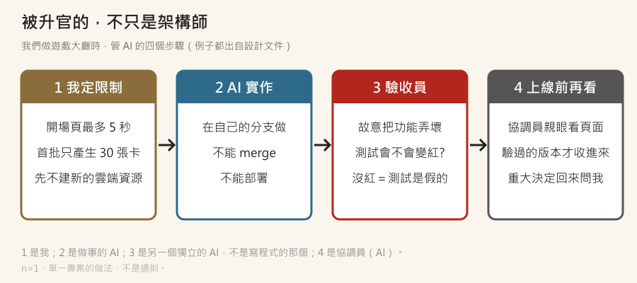

# 【AI 心得】你被「升官」成架構師了：從 HN 一篇爆紅的文章，看我們怎麼管 AI

昨天（11/20）Hacker News 上有一篇文章衝到 500 多分、近 300 則留言。
標題很直接：**〈我們把開發者升官成架構師，卻沒有告訴他們〉**。

文章最有名的一句話：

> "You got promoted. Nobody told you, so I am telling you."

意思是：你以為自己還是在寫程式，
但有了 AI 之後，你其實已經被調去做「架構」了。
（[原文](https://manidoraisamy.com/developer-to-architect.html)、[HN 討論](https://news.ycombinator.com/item?id=50579331)）

我一向對這種很紅的說法，先問一句「真的嗎?」
（這個習慣來自我很久以前寫的〈有錢人的口頭禪〉）。
剛好我們這兩個月都在用 AI 做遊戲，
就拿自己的專案來對一對。

---

## 一、文章講了什麼

作者 Mani Doraisamy 講了一個故事：

- 他在修一個很慢的 Google Forms 外掛，歡迎畫面要 **15 秒**才出來。
- 原因是同事用 vibe coding 加了「安裝紀錄」：先記 email，失敗就記 user id，再失敗就記錯誤訊息，每一步都打好幾次 Google API。
- 比較好的做法有兩種：只記安裝時間，或是先顯示歡迎畫面、再在背景記錄。

他的結論有三點：

1. AI 不會反駁你的需求，也不知道你的產品是剛上線還是有幾百萬人用，所以它會「照字面」做，架構自己挑。
2. 所以人的新工作，是在寫程式**之前**就把架構講清楚：資料怎麼放、什麼要刪、什麼不能慢。
3. 他認為「寫程式」這份工作會消失，「架構師」會留下來。

要先講清楚：這篇文章**沒有數據、沒有研究，也沒有說用的是哪個 AI 工具**，
就是一個人的經驗和判斷。

---

## 二、留言區吵什麼

我讀了留言區前面幾串（整串很長，後面我沒讀完），大概有三派：

- **「這不叫升官。」**有人說，架構也不是 AI 碰不到的領域，這篇像是在描述「不太會用 AI 的人」。
- **「一直不寫，判斷力會變鈍。」**有人說，程式設計師的價值是評估取捨，而寫程式是在磨這個判斷；AI 太快、公司又不鼓勵動手，這個回饋就斷了。
- **「這是勞動問題。」**有人把話題拉到工業革命：現在的開發者比較像被拖拉機取代的馬，不是被升官的農夫。

三派我都覺得有道理，
但都沒有回答最實際的問題：
**那到底要怎麼管 AI?**

---

## 三、我自己的 n=1：我們的遊戲大廳

我們做 [小羊遊戲間](https://csiesheep.com/?p=903) 的方式是：
一個 AI「協調員」負責拆工作、派給其他 AI 做前端、後端、文案，
我負責決定要什麼、不要什麼。
這個大廳的設計文件裡，到現在編號已經排到 **D68**（68 條決定），commit 超過 427 次（到 11/3）。

翻一翻這些決定，我找到三件事，剛好跟那篇文章對得上：

| 日期 | 發生什麼 | 誰決定 |
|---|---|---|
| 10/31 | 我請 AI 當 QA 找 bug，它的修法方案寫明：手機第一次下載 ≤ 1 MB、開場頁最多 5 秒一定關（對應文章的「15 秒」） | AI 提，我說「好」 |
| 11/1 | 準備上架 695 款遊戲時，我看到它要一次產生所有遊戲的頁面。我說：「等一下，能不能不要一次產生所有遊戲的頁面，分批產生好嗎」。改成第一批最多 30 張卡，滑到底再接下一批 | 我擋下來 |
| 11/1 | AI 的草案要建資料庫、每小時跑排程、加一個開關，收集玩家紀錄。我說：「了解，先不做匿名log」。結果它沒有建任何資源 | 我擋下來（兩天後我又改主意了，這是另一個故事） |

誠實講：
**這三件事裡，AI 不是只會「照字面做」**。
第一件，是它自己提的 5 秒。
這跟文章裡的情況不一樣，原因我覺得是：
我們給它**角色和規矩**。

我們的 TEAM.md 寫了：

- 協調員**絕不寫產品程式碼**（寫了就是自己驗自己）。
- 做事的 AI 只能在自己的分支做，**不能 merge、不能部署**。
- 要建新的雲端資源，**要我先核准**。

文章裡那個同事，是一個 AI 配一個人，沒有任何規矩，
這時候 AI 當然是「你講什麼就做什麼」。

---

## 四、我的結論：不只升官成架構師，還多了一個「驗收員」

那篇文章只講了一半。
架構師定好限制之後，還有一件事：
**你怎麼知道 AI 真的做到了?**

我們的設計文件有一段叫「證偽紀錄」。
做法是：每一條規則做好後，**故意把功能弄壞**，看測試會不會變紅。
如果測試沒紅，代表這個測試是假的。

舉一個真的例子（10/30）：
我們規定「同一個作者不能連續出現在 5 張卡裡」。
第一版測試寫完，我們故意把「排完順序後再修補」那一步拿掉，
**測試居然沒有紅**。
後來把測試擴成 30 天 × 2 台裝置 × 做完 0／2／5 款挑戰，
才抓到「22 處，第 88 到 92 張有同一個作者」。

如果沒有這一步，這個測試會一直是綠的，
我們會以為這條規則有人守著，
但其實沒有。

整個流程大概是這樣：

所以對我來說，「被升官」不是只有架構師，
至少還有一個：**驗收員**。
定限制是一半，
**確認限制真的有效，是另一半**。

---

## 五、誠實的限制

- 這是 **n=1**：一個人、一個專案、一組 AI，不能當通則。
- 我們的遊戲大廳是前端加一點後端，沒有複雜的資料一致性問題，大型系統可能不一樣。
- 那篇文章的作者說「寫程式會消失」，我不知道。我只知道在我們這個專案，要下的決定一點都沒有變少。
- 留言區說的「判斷力會變鈍」，我沒有數據可以反駁，也沒辦法用我的專案證明。

如果要我給一句話：
**AI 會照你說的做，所以重點是你說得夠不夠清楚，還有你有沒有去確認它真的做到。**

（前面我也寫過[用 AI 沒有變輕鬆](https://csiesheep.com/?p=860)、[一個人用 AI 做 10 款遊戲](https://csiesheep.com/?p=843)，講的是同一件事的不同面。）

你有被「升官」的感覺嗎?
有錯請指正 :)

\#被升官了沒人通知 #AI不會反駁你 #驗收員
