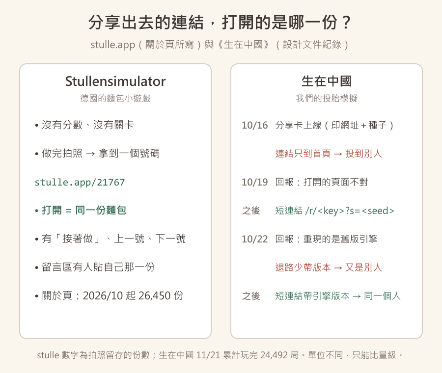

上週末 Hacker News 上有一個東西讓我愣了一下。

一個德國人做的網頁小遊戲：做麵包。
不是做三明治店、不是經營，就是——在一片麵包上抹奶油、疊起司、放香腸。
我抓下來的時候它有 350 多分、128 則留言，排在一堆黎曼猜想新聞旁邊。

沒有分數。沒有關卡。沒有輸贏。
那它到底憑什麼?

真的嗎?一個抹奶油的網頁，可以讓一群工程師吵上百則留言?
我去看了。看完覺得，答案不是麵包，是**網址**。

---

## 它到底是什麼

網站叫 [Stullensimulator](https://stulle.app/)（作者 Gregor Weichbrodt）。
Stulle 是德國人說的「開放式麵包」，就是只有下面一片、上面不蓋的那種。

照它「關於」頁的說法：
- 先抹醬：奶油、果醬、Nutella、夸克乳酪、肝醬。
- 再放二十多種料：起司、香腸、小黃瓜、荷包蛋、鮭魚，甚至薯條和小熊軟糖。
- 料是有物理的：蘿蔔放在蛋上會滑掉，小黃瓜推出麵包邊就會倒。
- 做完可以拍照，四個角度。**你留下的那張照片，會拿到一個號碼和一條網址。**

它自己講得很直白：「Keine Punkte. Keine Level.」（沒有分數，沒有關卡。——stulle.app 關於頁）
也沒有帳號、沒有廣告、沒有獎品。

每一份麵包的頁面長這樣：上面寫「Nr. 21.767」、什麼時候抹的、照片，然後一句話列出料：吐司、榛果醬、起司、四片香腸。
旁邊有「分享」、有「接著做」，還有上一號、下一號。
另外有一頁「全部的麵包」，寫著從 2026 年 10 月以來做了 26,450 份。

---

## 留言區在吵什麼

128 則留言我只讀了前面 60 則左右，所以下面是「前半段」的印象，不是全部。

吵最兇的居然是規則：
- 有人抱怨只能把奶油抹在麵包上，不能抹在別的東西上，給一星（開玩笑的）。
- 有人想把 Nutella 抹在起司上，系統不讓，底下一堆人回「那是禁忌」。
- 有人問上面那片麵包呢?德國人馬上出來解釋：Stulle 本來就不蓋，蓋起來的另有名字。
- 然後就是一整串文化戰：德國、奧地利、荷蘭的麵包上到底放什麼，要不要芥末，生菜是什麼。

但我覺得最重要的，是另一種留言：
**很多人直接貼自己那一份的網址。**
「這是我的」、「我叫它四根柱子疊疊樂」，有人點進去數，回一句：149 片香腸?!

你看，留言區自己變成了遊戲。
遊戲本身沒有分數，可是每一份作品都有號碼、有網址，
別人點得進去、看得到一模一樣的那一份，
於是「炫耀」「吐槽」「比賽誰比較離譜」就自然發生了。

這是我的推斷，不是作者說的。作者沒寫他為什麼要做號碼。

---

## 我們自己的 n=1：一個網址打不開同一個人

看到這裡我有點心虛。
因為我們的《[生在中國](https://games.csiesheep.com/china_life/)》也是一個沒有輸贏的遊戲：你投胎到中國古代某一年，過完一生，最後拿到一段生平和墓誌。

而我們在「網址」這件事上，摔過兩次。

翻了一下設計文件（docs/design.md）和 git log：

| 日期 | 發生什麼事 | 分享出去的連結會打開什麼 |
|---|---|---|
| 10/16 | 第一個 commit；同一天就有分享卡（卡上印網址和種子號碼） | 遊戲首頁，不是你這一生 |
| 10/19 | 回報：「QR 掃不出來或打開的頁面不對」 | 量到：連結只有 `?seed=1000`，按出生會投到別人 |
| 10/19 之後 | 改成短連結 `/r/<key>?s=<seed>`，伺服器查這一世當時的參數 | 同一個人、同一串選擇 |
| 10/22 | 回報：「分享連結重現的是舊版引擎」 | 查不到紀錄時走退路，引擎版本不對，又變成另一個人 |
| 10/22 之後 | 短連結多帶引擎版本 | 同一個人 |

也就是說，一開始那幾天，我們的分享卡很漂亮，
但朋友掃了 QR，看到的是**另一個人的一生**。

這有點像 Stulle 的號碼打開來，是別人的麵包。
那留言區就不會有人貼「這是我的 149 片香腸」了。

下面這張圖，是把兩邊放在一起比：

後來小羊遊戲間（hub）也碰到同樣的問題。
11/01 那天的紀錄是一句問句：「目前是不是整個網站都是同一頁？網址都不變」。
看完設計後的回覆是「照做」，於是每一款遊戲有了自己的 `/g/<id>`，分享出去的是那一款，不是首頁。
（[那篇介紹遊戲間的文章](https://csiesheep.com/?p=903) 寫的時候，這件事剛好在進行。）

---

## 那數字呢?

老實說，這裡我不敢講太多。

- Stulle：「關於」頁寫 2026 年 10 月以來 26,450 份麵包。
- 生在中國：11/21 的報告，累計玩完 24,492 局；那一天 257 局、56 位玩家。

兩個數字看起來差不多大，但**單位不一樣**：
一個是「拍照留下來的麵包」，一個是「玩完的一生」。
它的號碼也不是連號（全部列表會跳號），我不知道它怎麼算。
所以只能說：同一個量級。不能說誰比較成功。

更誠實的一點：
我們的伺服器在分享短連結轉址時會帶 `from=share`，
可是每天的報告沒有拆出「從分享連結進來的有幾個人」。
所以「修好網址之後，分享帶來的人有沒有變多」——**我不知道**。
這是下一個該量的東西。

---

## 誠實的限制

- n=1。我們只有自己一款遊戲的經驗，加上別人一個網站。
- HN 的留言我只讀了前半。後半可能有人很討厭它，我沒看到。
- Stulle 的玩法是照它的說明寫的，我沒有親手做過一份麵包。
- 「網址讓留言區變成遊戲」是推斷。也可能它紅只是因為好笑、因為週末、因為大家看黎曼猜想看累了。
- 我也不知道它的流量從哪裡來；它用自架的分析工具，沒有公開數字。

〈如何減少寫程式的風險〉裡我寫過：「最大的風險來自無知，要減少風險就是要減少不確定的因素。」
分享連結打不開同一個人，就是那種「做的人不知道、玩的人也不會跟你講」的未知。
它是有人真的掃了 QR、打開來不對，回報了才被發現的。

---

## 一句話

**沒有分數的遊戲，作品就是分數；而作品要能被別人看見，它得先有一個打得開的網址。**

做完一款小遊戲，不妨自己掃一次分享出去的 QR。
打開來，是不是同一份?

有錯請指正 :)

---

延伸閱讀：
- [不知道玩什麼?滑滑滑：我們開了一個遊戲大廳「小羊遊戲間」](https://csiesheep.com/?p=903)
- [生在中國：如果你投胎到中國古代，能活到幾歲?](https://csiesheep.com/?p=800)
- [做遊戲每一關都難，最難的是讓人找到：從 4388 小遊戲說起](https://csiesheep.com/?p=872)

來玩玩看：[小羊遊戲間](https://games.csiesheep.com/)、[生在中國](https://games.csiesheep.com/china_life/)

#沒有分數也能吵一百則 #Nutella不能抹在起司上 #先掃自己的QR #每份作品一個網址
