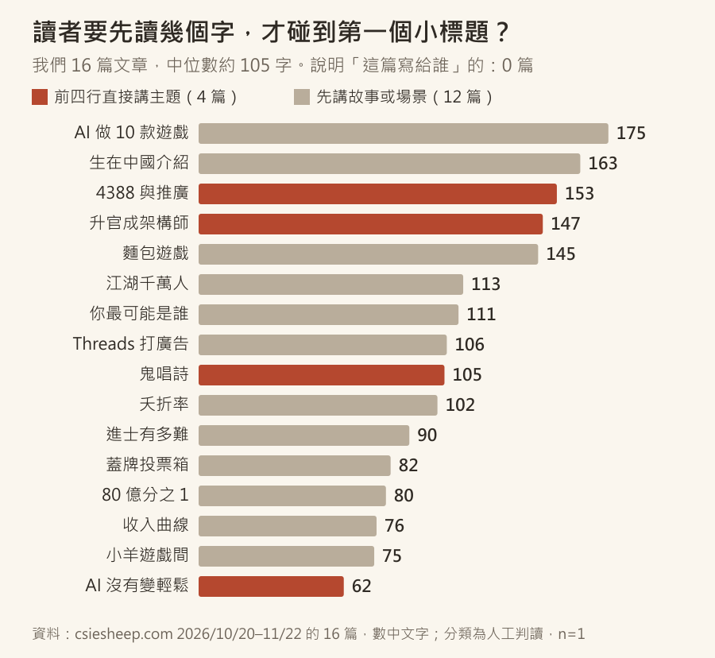

# 【技術筆記】假設沒人想看你的文章：我數了自己 16 篇開頭，0 篇說這篇是寫給誰的

這篇是寫給「有在寫東西給別人看」的人。
部落格、Threads、公司群組裡的長訊息都算。

如果你沒在寫，可以關掉了，
我不會難過的 XD

（好，這個開頭不是我的風格。
是照著 Hacker News 上一篇文章的建議，第一次這樣寫。）

---

## 一、文章說了什麼

這篇叫〈[Assume People Are Not Interested in Your Blog Post](https://danielsada.tech/blog/assume-people-are-not-interested-in-your-blog-post/)〉，
作者 Daniel Sada，11 月 22 日發的。
我抓下來的時候有 253 分、130 則留言。

全文標示一分鐘讀完，核心就一句：

> "Write for your reader: tell them up front who this is for"

他的論點大概是這樣：

1. 他以前在 Snowflake，公司有個 email 禮儀：**第一句話就告訴你，什麼情況可以不用往下讀。** 例如「如果你不是財務部門的人」。
2. 所以寫東西時，要想想自己佔了別人多少注意力。
3. 在 Slack 或 Teams 上，先寫 3 到 5 行，細節放到討論串裡。
4. 寫了 2,000 字、內容卻不是人人適用的貼文，是在浪費讀者的眼睛。

要先講清楚：
這篇**沒有數據、沒有研究**，就是一個人的工作經驗和建議。
所以我一樣先問一句「真的嗎?」
（這個習慣來自我很久以前寫的〈[有錢人的口頭禪](https://csiesheep.com/?p=21)〉）。

---

## 二、留言區在吵什麼

留言我逐字讀了大約一半，後面只看了摘要，
所以下面是「我看到的部分」：

- **最多人說：部落格本來就是寫給自己的。** 寫作是在整理思考，有人看是賺到。不過也有人補充，就算寫給自己，也要寫到未來忘記前因後果的自己看得懂。
- **公司和部落格不一樣。** 群發信確實該先說跟誰有關，但個人部落格沒有義務服務每個路人。
- **現在讀你文章的，可能根本不是人。** 不少人說自己的流量大多是爬蟲和 AI 抓取。
- **標題和摘要就該做這件事。** 有人覺得好標題已經告訴讀者要不要點，也有人覺得多寫摘要很煩。

我覺得第一派和作者其實沒有吵起來。
一個在講「為什麼寫」，一個在講「寫出來之後怎麼對待讀者」。

但光想沒有用，
不如拿自己當白老鼠。

---

## 三、我把自己的 16 篇拿出來數

這兩個月（10/20 到 11/22）我寫了 16 篇遊戲和 AI 的文章，其中一篇還沒公開。
這些文章是我和 AI 一起寫的，所以這個檢查也算是在檢查我們的共同習慣。

我讓 AI 數了三件事：開頭有沒有說這篇給誰看、開頭是直接講主題還是先鋪陳、讀者要讀多少字才會碰到第一個小標題。

| 量什麼 | 結果 |
|---|---|
| 前四行說明「這篇寫給誰」 | **0 篇** |
| 前四行就講明要談什麼 | 4 篇 |
| 先講故事或場景 | 12 篇 |
| 第一個小標題前的中文字數 | 中位數約 105 字（62 到 175） |
| 全文中文字數 | 中位數 1,353 字 |

0 篇。
非常整齊，整齊到有點好笑 orz

下面這張圖是每一篇在第一個小標題之前，讓讀者先讀了多少字：

看起來 105 字不多。
但這 105 字裡，大部分在講「小時候讀歷史」「11 月 28 日要投票了」這種場景。
讀者讀完還不一定知道：**這篇跟我有關嗎?**

更早的舊文反而不太有這個問題。
10 月盤點 2008 年以來的 57 篇舊文時，中位數只有 549 字，
很多標題長這樣：〈【筆記】如何設定 sudo 權限?〉〈【筆記】WordPress 固定網址設定〉。

一看就知道要不要點。
我猜那些筆記當時大概是寫給未來的自己，
結果標題反而把「給誰看」講得最清楚。

---

## 四、可是我們才剛規定要「留懸念」

這裡有個矛盾。

10 月 23 日，我們有一則《生在中國》的 Threads 貼文，把一個古代女生的一生從頭寫到 70 歲過世。
我當時的反應是：

> 「Threads 上文案部分不要把一生全寫完，留懸念」

後來又補一句：「所有文案都留懸念」。

一邊說「開頭就要交代清楚」，
一邊說「不要全講完」，
到底要聽誰的?

我想了一下，這兩件事可能根本不衝突。

- **「這篇給誰看」是入口。** 不知道入口，讀者不會進來。
- **「最後發生什麼事」是內容。** 先講完，讀者就不用進來了。

Sada 要求的是前者，
留懸念擋的是後者。
可以在第一行說「這篇給想知道古代女生能活多久的人」，
然後**不告訴你她活到幾歲**。

反過來看我們 10 月那次[在 Threads 到處打廣告](https://csiesheep.com/?p=861)：
四天下來，追蹤人數 0。
那時候犯的錯，某種程度上就是沒有先假設「對方對我的遊戲沒興趣」。
（這是我事後的推斷，當時失敗的原因不只這一個。）

---

## 五、我不知道的事

照慣例列一下未知：

- **我沒有讀者行為的數據。** 我沒量過跳出率或停留時間，所以不能說「改開頭會變好」。
- **n=1，而且只有 16 篇。** 分類是看前四行判斷的，有幾篇邊界模糊。
- **「給誰看」也可能趕走人。** 有些文章的樂趣就是你本來以為跟你無關，讀完才發現有關。如果第一行就把人篩掉，可能少了這種意外。
- **字數不能直接比。** 作者講的 2,000 字是英文 words，我數的是中文字。

所以我不打算把 16 篇全部改掉。
最小的實驗是：**之後幾篇，開頭先寫一行「這篇給誰」，再看有沒有差。**
沒量到之前，我不知道它有沒有用。
這也是〈[如何減少寫程式的風險](https://csiesheep.com/?p=70)〉那篇一直在講的事：先減少不確定的部分。

---

## 一句話

**開頭告訴讀者這篇是給誰的，但不用告訴他結局。**

如果你剛好是這篇開頭說的那種人，
可以回頭看看自己最近三篇的前四行。
如果你是來玩遊戲的，走錯棚了，
[生在中國](https://games.csiesheep.com/china_life/)在這裡，[其他遊戲](https://games.csiesheep.com/)在這裡。

相關文章：
- [做遊戲每一關都難，最難的是讓人找到](https://csiesheep.com/?p=872)
- [用了 AI，我沒有變輕鬆](https://csiesheep.com/?p=860)

以上是一些小小的心得，有錯請指正 :)

\#寫給誰看 \#我數了之後有點想裝沒看到 \#本篇開頭也是現學現賣 \#留懸念但不留路障
