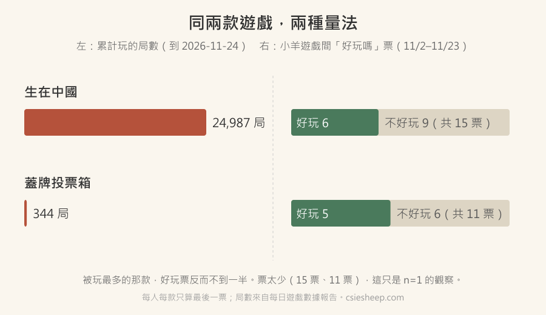

# 【AI 心得】AI 做「好玩」的遊戲突然變簡單了?我翻了自己的「好玩嗎」按鈕

Simon Willison 在 10 月底寫了一篇文章，
標題大意是：2026 年 10 月，是用 vibe coding 做遊戲的轉折點。

他的意思是，
以前 AI 做得出「長得像遊戲」的東西，
現在它做得出「好玩」的遊戲了。

我第一個反應是：真的嗎?
第二個反應是：等等，我自己好像有一點資料可以對一下。

因為我們的遊戲大廳 [小羊遊戲間](https://games.csiesheep.com/)，
每款玩完都會問一句「好玩嗎?」。

---

## 他說了什麼

原文在這：[The October inflection point for vibe game development](https://simonwillison.net/2026/Oct/28/vibe-game-development/)（2026-10-28）。

我整理一下他的論點，照順序：

1. 2025 年 11 月，coding agent 變成可以每天用的工具；他覺得 2026 年 10 月是第二個轉折，這次是遊戲。
2. 他說新的模型在三件事上變強：3D、做音樂、還有遊戲設計。最後一項他說最重要。
3. 關鍵是一句提示：叫它把遊戲「做得好玩很多」，它真的會去改機制，而不只是換顏色。
4. 他舉了四款自己做的網頁遊戲：一款找不同、一款小型 RPG、一款即時戰略、一款農場遊戲。每款他自己花的時間不超過四小時。
5. 即時戰略那款最完整：七張地圖、2 到 4 人連線，還開源了，已經有人拿去改。
6. 他也承認，農場那款他自己都覺得還不夠好玩；而且他說自己不太懂遊戲設計。
7. 最後他鼓勵大家：去做一個遊戲吧，網頁、手機都跑得動，放上免費的靜態主機就好。

他整篇最短的一句結論大概是這句：
「Building games that play well is shockingly easy now.」（Simon Willison）

---

## 那篇文章裡沒有的東西

我很喜歡 Simon 的文章，他通常寫得很誠實。
但我還是想先列一下這篇**沒有**的東西：

- 沒有玩家人數。
- 沒有任何人打分數，也沒有問卷。
- 沒有定義「好玩」怎麼量。
- 模型之間的比較，是他自己玩過之後的印象。

所以這篇的證據是：一個很會寫程式、但說自己不太懂遊戲設計的人，玩自己做的遊戲，覺得好玩。

這不代表他錯。
只是 n=1，而且那個 1 是作者本人 XD

---

## 留言區在吵什麼

我去看了 Hacker News 的討論（47 分、54 則留言）。
頂層留言有 14 則，我讀了其中 12 則，有兩則抓不到內容。

大概分成三派：

- **不覺得好玩派**：有人說他實際玩了那幾款，覺得無聊；也有人說，用現成的遊戲引擎本來就能很快做出簡單遊戲。
- **擔心派**：怕市場被大量粗製濫造的遊戲淹沒，新手開發者更難被看見。
- **支持派**：有人說 AI 對他做正式的遊戲很有幫助，小規模的遊戲現在確實做得起來。

Simon 自己在底下回覆，說讓即時戰略變好玩的改動是：開局的選擇、落後時有翻盤的機會、軍隊會往地圖中央集結。

我覺得有趣的是：
雙方吵的，其實是同一個問題——「好玩」到底是誰說了算?

---

## 我自己的 n=1：好玩票

小羊遊戲間 v1 的時候決定不開留言，
只放兩顆鍵：好玩、不好玩。（hub 設計文件 D12，2026-10-30）
11 月 2 日起，這些票開始存進資料庫。

我今天去查了一下，從 11/2 到 11/23，
每個人對每款只算最後一票：

| 項目 | 數字 |
|---|---|
| 收到的票 | 160 票 |
| 說「好玩」的 | 71 票（約 44%） |
| 有被投票的遊戲 | 101 款 |
| 票最多的一款 | 15 票 |

先講清楚：這 101 款裡，大部分是我們收錄的外站遊戲，不全是 AI 做的。
所以這個 44% 不能讀成「AI 做的遊戲只有 44% 好玩」。

比較好玩（咦）的是我們自己的幾款：

| 遊戲 | 累計玩的局數 | 好玩票 |
|---|---|---|
| [生在中國](https://games.csiesheep.com/china_life/) | 24,987 局 | 6 / 15 |
| [蓋牌投票箱](https://games.csiesheep.com/covervote/) | 344 局 | 5 / 11 |
| [天地會](https://games.csiesheep.com/tiandihui/) | （沒算） | 2 / 3 |
| [Dice Wars](https://games.csiesheep.com/dice_war/) | （沒算） | 3 / 3 |

（局數來自每天的遊戲數據報告，截至 2026-11-24；好玩票來自小羊遊戲間。）

生在中國是被玩最多的一款。
11/18 那天，有一位（其實是一個網路位址）一天玩了 140 局。
但在大廳按「好玩」的，15 個人裡只有 6 個。

兩個數字看起來在打架。
我猜幾個可能：

- 會回到大廳按鈕的人，本來就不是那個玩 140 局的人。
- 生在中國是「看一生」的遊戲，有人覺得有意思，但不一定會用「好玩」這個詞。
- 15 票實在太少，換兩三個人，比例就整個翻過來。

我真的不知道是哪一個。

---

## 做出來變簡單了，這點我同意

另一個角度是時間。

依 git log，蓋牌投票箱的第一個 commit 是 10/21 早上，
10/22 傍晚已經在修首頁的小問題了，總共 153 個 commit。
生在中國從 10/16 開始，到 11/21 有 1,333 個 commit，現在還在加東西。

所以「做出一款能玩的遊戲很快」這件事，我這邊的紀錄跟 Simon 說的是一致的。

但「做得快」跟「大家覺得好玩」是兩件事。
蓋牌投票箱做得最快；生在中國花最久、被玩最多。
這也只是兩款，不能拿來說「花越久越好玩」。

---

## 誠實的限制

- 好玩票只有三個禮拜、160 票，單款最多 15 票。
- 我們自己訂的「公認好玩」門檻是至少 30 票、85% 好玩，**目前沒有任何一款夠票**。
- 玩家數是用網路位址估的，同一個 Wi-Fi 的一家人算一位，而且有取樣。
- 我沒有像 Simon 那樣同一個點子用兩個模型各做一次，所以不能說哪個模型比較會做好玩的遊戲。
- 我沒有量「玩多久」，也不打算在大廳顯示這種數字。

用〈如何減少寫程式的風險〉裡我很久以前寫過的一句話：
最大的風險來自無知，要減少風險就是要減少不確定的因素。

以前做遊戲，最大的未知是「做不做得出來」。
現在這個未知好像真的變小了。
剩下最大的未知，變成「有沒有人覺得好玩」——而這題，AI 幫不了你投票。

---

## 一句話

**AI 讓「做出來」變簡單了，但「知道好不好玩」沒有變簡單；要知道，得先有人玩、還要有人願意按那顆鍵。**

如果你剛好玩過我們的遊戲，玩完按一下「好玩嗎」就好，按「不好玩」也很有幫助 :)

---

## 延伸閱讀

- [一個人用 AI 做了 10 款網頁遊戲：分工、驗證與踩過的坑](https://csiesheep.com/?p=843)
- [用了 AI，我沒有變輕鬆](https://csiesheep.com/?p=860)
- [做遊戲每一關都難，最難的是讓人找到：從 4388 小遊戲說起](https://csiesheep.com/?p=872)
- [不知道玩什麼?滑滑滑：我們開了一個遊戲大廳「小羊遊戲間」](https://csiesheep.com/?p=903)

有錯請指正 :)

#vibecoding #好玩是誰說了算 #n等於1 #15票也是票 #AI做得出來不代表有人玩
