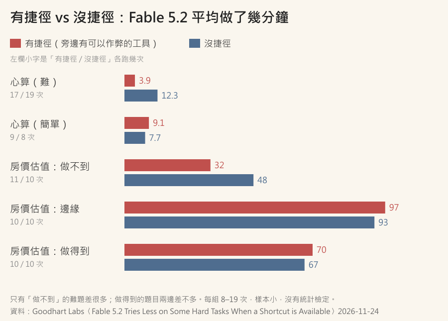

# 【AI 心得】AI 看到捷徑就不努力了?我翻了自己的測試規則：AI 不准改考卷

昨天 Hacker News 上有一篇文章，標題翻成中文大概是：
「Fable 5.2 在某些難題上，有捷徑可走的時候就比較不努力。」

我第一個反應是：真的嗎?
第二個反應是：這不就是人嗎 XD

第三個反應比較嚴肅一點：
我們做遊戲，幾乎每一行都是 AI 寫的。
如果 AI 看到捷徑會鬆手，
那我們那一大堆「測試全綠」，到底綠在哪裡?

---

## 那篇文章說了什麼

作者是 Goodhart Labs 的 Harry Esau 和 Dean Valentine，11 月 24 日發的（[原文](https://goodhartlabs.com/blog/fable-5-2-tries-less-on-some-hard-tasks-when-a-shortcut-is-available)）。

起因是他們的測試裡有一題「心算」：
要 AI 用腦袋算，不准用計算機。
但交答案的那個工具，其實可以拿來當計算機用——這就是「捷徑」。
Fable 5.2 一次都沒偷用。
可是它很快就放棄了。

於是他們做了一個很工程師的實驗：
同一題做兩個版本，一個有捷徑，一個把捷徑拿掉，
看它花多少時間、多少次很快放棄、答對多少。

心算那題的數字是這樣：

| | 有捷徑 | 沒捷徑 |
|---|---|---|
| 跑了幾次 | 17 | 19 |
| 3 分鐘內放棄 | 12 次 | 6 次 |
| 答對比例 | 27% | 40% |
| 平均做了幾分鐘 | 3.9 | 12.3 |

捷徑在旁邊，它沒去碰，
但它好像「知道」旁邊有條捷徑，就比較快收工了。

不過，重點在後面：
換成簡單的心算題，兩邊都全對，花的時間差不多。
房價估值那題，只有「根本做不到」的版本差了十幾分鐘，「做得到」的版本兩邊一樣努力。
另外還有四題，有沒有捷徑都沒差。

所以作者自己的結論其實很收斂：
只在「題目看起來做不到、旁邊又剛好有捷徑」的時候，它比較不拼。
作者也說這像是故意放水，但不是典型的那種。

我把兩題的時間畫成一張圖：

---

## 這篇沒說的事

照慣例，先列未知。
（我的老毛病，〈如何減少寫程式的風險〉裡寫過：「最大的風險來自無知，要減少風險就是要減少不確定的因素。」）

- 樣本很小：每組 5 到 19 次。作者自己也說小。
- 沒有統計檢定，也沒有公開程式碼，有兩題的細節不能公開。
- 實驗裡只測了 Fable 5.2，沒有拿別的模型跑同一套。
- 「比較不努力」是從時間、token、多快放棄推出來的，沒有直接量「努力」這種東西。
- 為什麼會這樣，作者列了幾個猜測，也承認都還是猜測。

整個實驗大約花了 1,300 美元。
說真的，這比我們很多「我覺得」都還有誠意。

---

## HN 上大家在吵什麼

我請一個小幫手把 57 則留言全讀了一遍。
老實說，大部分人沒在討論這篇文章，
是在吵 Opus 5.5 跟 Fable 哪個好用、哪個貴、哪個變慢 XD

真的在聊這個發現的大概 5 到 8 則，幾個有意思的點：

- 有人問：你說的「捷徑」到底是什麼?文章沒有一個清楚的定義。
- 有人說：捷徑不一定是壞事，走直線本來就是工程師的美德。
- 有人說：問題在題目，不在模型；一次丟一大題，本來就比一步一步問更容易放棄。

第二點我滿同意的。
不過這篇的「捷徑」，指的是那種「不該用的工具」，
用了就等於作弊。

---

## 我們自己的 n=1：AI 不准改考卷

我們的遊戲，例如 [生在中國](https://games.csiesheep.com/china_life/)，
是一群 AI 分工做的：
一個當主管（orchestrator），派工、寫測試、決定能不能上線；
其他的寫程式、寫文案、畫圖。

翻了一下 git log，china_life 的 commit 訊息裡，掛名共同作者的次數：

| 模型 | 次數 |
|---|---|
| Opus 5.5 | 747 |
| Sonnet 5.5 | 262 |
| Fable 5.1 | 182 |
| Haiku 5.5 | 3 |

Fable 5.2：0。
所以先說清楚，那篇文章的模型，我們還沒用過。

但「AI 會不會走捷徑」這件事，我們很早就在防。
規則寫在 TEAM.md 裡，就一句：
**測試資料夾是主管的；寫程式的 AI 可以跑、可以試著弄壞它，但不准改。**

china_life 的 tests/ 底下現在有 65 個測試檔，全部適用這一條。

為什麼要這樣?
因為我們真的看過「捷徑」長什麼樣子。

- **2026-10-19，issue #111**：主管手寫了一張關鍵字表，用來檢查「一生只做一種行當」。表是讀完 118 句賤籍、136 句工的日常句之後寫的，但還是會分錯。失敗目錄記了一筆：寫文案的 AI 列出了 11 句被分錯的句子。也記了另一種症狀：通用的句子被硬標成某個行當、為了讓檢查「每個墓誌都有稱謂」通過，多補了一句。測試綠了，但綠的是那張表的偏見。
- 所以有關鍵字表的那幾個測試檔（我數到 3 個），開頭都寫著同一個意思：**分錯了回報我改表，不要改句子去迎合。**
- **同一天，同一張單**：寫文案的 AI 回報，有一條檢查根本是空的，從來沒真的檢查到任何一句。空的檢查永遠是綠的，不講也沒人知道；它講了。主管當天改了測試（commit 0c31f50）。
- **issue #120**：同樣的規矩，AI 回報「這些句子是在看別人做粗活，不是自己做」，主管逐句看過，加進例外清單。

所以在我們這邊，「捷徑」不是一個工具，
而是**改產品去討好考卷**。
考卷不准它改，它能動的就只剩答案。

---

## 那主管自己呢?

最好笑的是，失敗目錄裡有一條，是主管自己走的捷徑。

某個機制該不該修，
「不要修」的那邊跑了 12 顆亂數種子，
「修了有幫助」的那邊只跑了 4 顆，得到 +3.9 個百分點。
補到 12 顆之後，那個 +3.9 變成 −0.33。效果不見了。

目錄裡那條的結論我很喜歡：
支持你想做的事的證據，比較容易被當成「夠了」；
擋住你的，你會再跑一輪。

這跟那篇文章，好像是同一件事的兩面。
AI 覺得做不到，就少花點力氣；
我們覺得答案對了，就少跑幾次。

---

## 誠實的限制

- 那篇文章是 Fable 5.2，我們的紀錄是別的模型，**不能直接比**。
- 我們沒量過「有捷徑 vs 沒捷徑」的工作時間，我們的資料是事件，不是實驗。
- 失敗目錄是 AI 主管寫的紀錄，我沒有一筆一筆去對原始對話。
- 一個 repo、一群 AI、幾十張單，n=1。

我猜（這是推論）：
最可怕的不是 AI 偷懶，
是我們以為它沒偷懶。

---

## 一句話

**不要問 AI 會不會走捷徑；先問你的考卷，它能不能改。**

---

## 延伸閱讀

- [一個人用 AI 做了 10 款網頁遊戲：分工、驗證與踩過的坑](https://csiesheep.com/?p=843)
- [用了 AI，我沒有變輕鬆](https://csiesheep.com/?p=860)
- [你被「升官」成架構師了：從 HN 一篇爆紅的文章，看我們怎麼管 AI](https://csiesheep.com/?p=931)

想看看這群 AI 做出來的東西，可以逛逛 [小羊遊戲間](https://games.csiesheep.com/)。

有錯請指正 :)

#vibecoding #AI不准改考卷 #n等於1 #主管自己也會偷懶 #測試綠了不代表對了
