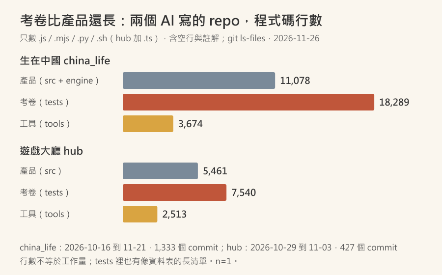

# 【技術筆記】AI 放大的是坐在鍵盤前的人?我數了自己的程式碼：考卷比產品還長

這週 Hacker News 上有一篇文章，標題很直接：
〈Smart people who give a shit use tools〉。
翻成中文大概是：真的在乎的聰明人，會用工具。

348 分，273 則留言。
吵得很兇。

我看完第一個反應還是那句：真的嗎?
第二個反應是：那我們家的人，算哪一種?

---

## 文章在說什麼

作者是 Ian K. Duncan，2026-11-19 發的。
[原文在這](https://www.iankduncan.com/engineering/2026-11-19-smart-people-who-give-a-shit-use-tools)。

他在回另一篇文章。
那篇說：公司用生成式 AI 取代了「真的在乎的人」，所以事故變多了。
Duncan 同意主管該被罵，
但不同意「工具本身就是問題」。

他的主張大概是這幾步：

1. 以前「在乎」是被時間配給的。大家知道該寫規格、該寫性質測試、該讀完那個四萬行的服務，但實際上多半是看一眼 diff 就按下去。
2. 有了好模型，在乎的人終於可以把那些事做完：寫 TLA+、做假的第三方 API 來模擬、把舊函式的呼叫者全部追一遍、跑 mutation testing。
3. 他也承認壞處：1,500 行的 PR「全部接受」、800 行生成的程式自己腦中沒有模型；而且 LLM 出錯的時候，是用很流暢的文字出錯，不像編譯器會大聲罵你。
4. 但是，不在乎的工程師在 LLM 之前就有了。以前是貼 Stack Overflow 第一個答案、三十秒寫 LGTM。
5. 真正的在乎，看得見：對帳腳本、監控、靜態檢查、runbook、自己做的小工具。

他的結論一句話：
「LLMs mostly amplify whoever is sitting at the keyboard.」
（LLM 主要放大的，是坐在鍵盤前的那個人。）

要注意的是：
整篇**沒有任何數據**。
沒有研究、沒有事故統計、沒有「用 AI 的團隊 vs 不用的團隊」比較。
它是一篇主張，不是一份報告。

---

## 留言區在吵什麼

273 則我沒有讀完，
只讀了前面大約 60 則（第一、二層）。
我看到的幾種聲音，改寫如下：

- 有人說：以前跑得快、留一堆 bug 給別人收的人就拿掌聲，AI 只會讓這件事更明顯。
- 有人說：AI 叫你寫 TLA+，可是你不懂 TLA+，那你要怎麼驗它?在乎的成本反而變高。
- 有人說：AI 的記憶只有一個 context window。另一個人回：那就叫它寫筆記啊。
- 然後最好笑的一串：有人把文章丟進 AI 偵測工具，說這篇看起來是 AI 寫的，讀到一半就不讀了；也有人回那種工具不一定準。

一篇替「用 AI」辯護的文章，
被懷疑是 AI 寫的。
這很冷，但我覺得也很誠實地點出問題：
讀者沒辦法從結果看出你在不在乎。

所以我也誠實說一句：
**這篇的初稿也是 AI 幫我寫的**，我再讀過、改過才放出來。
（這個部落格現在的流程就是這樣：AI 找題目、寫草稿，我讀、我改、我決定要不要公開。）

---

## 那我們家呢?n=1 的數字

文章說「在乎」會留下痕跡：工具、檢查、腳本。
那就來數。

我們的《生在中國》（china_life），
從 2026-10-16 第一個 commit 到 2026-11-21，
幾乎每一行都是 AI 寫的。
我用 git 數了程式碼的行數（只數 .js、.mjs、.py、.sh，含空行和註解）：

| 資料夾 | 是什麼 | 行數 | 檔案數 |
|---|---|---|---|
| src/ + engine/ | 遊戲本身 | 11,078 | 45 |
| tests/ | 驗收考卷 | 18,289 | 76 |
| tools/ | 自己做的工具 | 3,674 | 20 |

考卷比產品還長。
長了大約 1.65 倍。

遊戲大廳那個 repo（hub）也一樣：
產品 5,461 行，考卷 7,540 行，工具 2,513 行。

畫成圖大概長這樣：

其他幾個數字：

- china_life 一共 1,333 個 commit，其中 498 個動到 tests/，大約 37%。
- commit 訊息裡出現 falsify 或「證偽」的有 110 行。我們的規則是：考卷寫好之後，要故意把產品弄壞一次，看考卷會不會紅。不紅，就代表考卷是假的。
- 有 7 個 commit 的標題寫著「洞」。例如 2026-10-16 那個：「第 22 組：三個洞（#29 的 peer 指出）」。意思是寫程式的 AI 回頭指出：考卷有洞，它其實可以混過去。那次補的其中一個洞是：比較兩個數字之前，要先確定它們真的是數字。不然算出一個「不是數字」的結果，跟什麼比都可能不會報錯，考卷就一路綠下去。
- tools/ 裡有一支 orch.sh，專門做這些麻煩事：開一個乾淨的工作樹、故意破壞一個檔案、還原、檢查樹上不能有殘留的破壞。

---

## 所以作者對嗎?

我覺得，對一半。

對的那一半：
如果沒有 AI，
我一個人大概不會寫 18,000 行的考卷。
光是想到就累。
在這件事上，AI 確實放大了「想檢查」的那一面。

我不確定的那一半：

- **行數不等於在乎。** 考卷裡有很多是長清單，像資料表一樣。行數多，可能只是囉嗦。
- **考卷也是 AI 寫的。** 誰來考考卷?我們的答案是「故意弄壞產品，看它紅不紅」，但這只能抓到我們想得到的壞法。
- **沒有對照組。** 我沒有一個「不用 AI 的我」來比較，n=1，而且還是同一個人做的兩個 repo。
- **放大是雙向的。** 如果 AI 放大鍵盤前的人，那它也會放大我偷懶的那一天。我猜（這是推論）：真正的風險不是哪天不在乎，是不知道自己哪天不在乎。

很久以前我寫過一句：
「最大的風險來自無知，要減少風險就是要減少不確定的因素。」
（〈如何減少寫程式的風險〉）
十幾年後換成 AI 寫程式，
這句話好像沒有過期。
考卷、證偽、工具，
說穿了都是在把「我不知道它對不對」變少一點。

---

## 一句話

**在乎看不出來，但數得出來：去數你的考卷跟工具，有沒有比產品還長。**

---

## 延伸閱讀

- [一個人用 AI 做了 10 款網頁遊戲：分工、驗證與踩過的坑](https://csiesheep.com/?p=843)
- [用了 AI，我沒有變輕鬆](https://csiesheep.com/?p=860)
- [你被「升官」成架構師了：從 HN 一篇爆紅的文章，看我們怎麼管 AI](https://csiesheep.com/?p=931)
- [如何減少寫程式的風險，作出較精確的時程估計](https://csiesheep.com/?p=70)

這群 AI 跟它們的考卷做出來的遊戲，在 [小羊遊戲間](https://games.csiesheep.com/)，
《生在中國》在 [這裡](https://games.csiesheep.com/china_life/)。

有錯請指正 :)

#技術筆記 #考卷比產品長 #n等於1 #這篇初稿也是AI寫的 #在乎要數得出來
