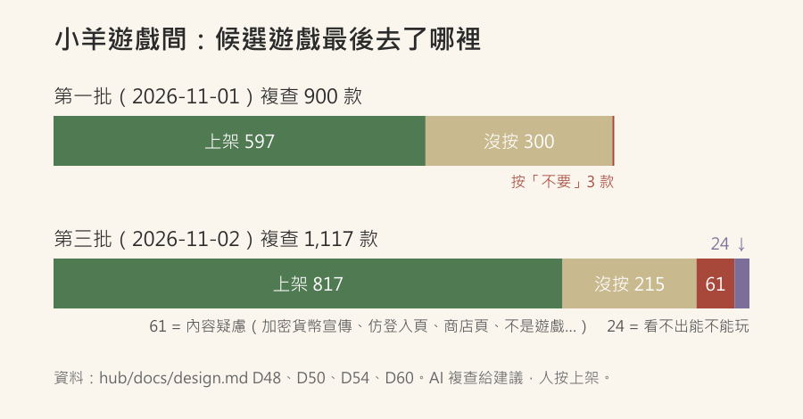

# 【遊戲開發日記】itch.io 刪了好幾 TB 的「AI 垃圾」：我們的遊戲也是 AI 做的，算不算?

這個月初，獨立遊戲平台 itch.io 在 X 上說了一句很嗆的話：
「just deleted a couple terabytes of AI slop」（itch.io 官方帳號，經 [80.lv](https://80.lv/articles/itch-io-revises-ai-content-policies-after-removing-ai-generated-games/) 轉引）。
翻成中文大概是：剛剛刪了好幾 TB 的 AI 垃圾。

我第一個反應是拍手。
第二個反應是心虛。
因為我們的遊戲，幾乎每一行程式都是 AI 寫的。
生在中國的水墨肖像，也是本機的 ComfyUI 畫的。

所以真的嗎?
我們做的東西，算不算 slop?

---

## itch.io 到底說了什麼

先把報導和 itch.io 自己的準則讀完。
重點我整理成幾條：

- 過去兩個月，itch.io 每天新開的遊戲頁**翻倍**，但下載和購買沒有跟著翻倍（[PC Guide](https://www.pcguide.com/news/itchio-outlines-what-the-limit-is-for-ai-generated-content-after-its-spree-of-mass-deletion/) 引 itch.io 的說法）。
- 圖片和主機的成本跟著漲，所以開始刪。
- 新增「No AI」篩選：玩家可以把有勾「用了生成式 AI」的遊戲，從搜尋結果拿掉（80.lv）。
- 它**沒有**禁止用 AI 做的遊戲。

真正的界線寫在 [itch.io 的品質準則](https://itch.io/docs/creators/quality-guidelines) 裡。
會被當成 spam、從瀏覽和搜尋拿掉的，是這三種：

1. 主要由 AI 做、幾乎沒有人介入的遊戲。
2. 隨機產生、沒有經過設計的內容。
3. 同一個東西，用 AI 做出很多個版本。

另外，用到生成式 AI 要自己勾揭露。
NPC 尋路、程序生成關卡這種「老派的遊戲 AI」不用勾。

報導裡沒有的東西也值得記一下：
沒說刪了幾頁、沒說怎麼抓的、也沒有任何準確率。
PC Guide 提到有人擔心「誰來判定什麼是垃圾」，但沒說是誰。
PC Gamer 的原文我抓不到內文，所以這篇沒有用它的任何內容。

---

## 換個角度：這是誰的問題?

讀到「頁面翻倍、下載沒翻倍」那句，我想起《真正的問題是什麼?》。
表面的問題是「AI 遊戲太多」。
但對玩家來說，真正的問題是**找不到值得玩的**。
對 itch.io 來說，是**頻寬和儲存的帳單**。

這兩個問題，我們剛好都碰過一次。
只是我們站在另一邊：我們不是做遊戲的那一方，是挑遊戲的那一方。

帳單那個，規模小很多，但味道一樣。
遊戲間每款遊戲配一張截圖，第一批上架時，截圖總量的上限從原本訂的改成手機、電腦各 40 MB；第三批再上 817 款，上限又從 40 MB 拉到 100 MB。
每一款多收一張圖，就是多一份要放、要載的東西。
所以 itch.io 說「頁面翻倍、下載沒翻倍」時，我大概懂那張帳單長什麼樣子。

---

## 我們的 n=1：小羊遊戲間的「上架」是怎麼做的

[小羊遊戲間](https://games.csiesheep.com/) 收的大多是別人的網頁遊戲，主要從 4388 的排行榜和 Threads 找來。
每一款都先由 AI 開頁、截圖、手機和電腦各判一次，給一個建議。
然後由人在審核頁按「上架」或「不要」。

翻了一下 hub 的設計文件，兩批的數字是這樣：

| 批次 | 複查 | 按上架 | 排除 | 最後上架 |
|---|---|---|---|---|
| 第一批（2026-11-01） | 900 款 | 597 款 | 沒按 300、按不要 3 | 597 款 |
| 第三批（2026-11-02） | 1,117 款 | 902 款 | 沒按 215；按了的裡面再排除內容疑慮 61、看不出能不能玩 24 | 817 款 |

第一批的「可以玩」只有三個條件：開得起來、不用登入或付費、內容 ok。
第三批排掉的 61 款，原因是加密貨幣宣傳、仿登入頁、商店頁、根本不是遊戲之類。

把兩批疊在一起看比較清楚：

今天的總表一共 2,121 列，其中上架 1,513 款（自家 4 款、4388 來的 1,419 款、Threads 來的 90 款），還在候選的 603 款。
上架之後還有一道：玩家可以按「回報」，14 天內有 3 台以上不同裝置回報的款，會進審核頁讓人決定。
不自動下架。

---

## 然後我發現一件有點尷尬的事

我們的審核，**從來沒問過「這是不是 AI 做的」**。
總表裡沒有這個欄位。
我用關鍵字去搜 2,117 筆複查紀錄，提到 AI 的只有 15 筆，而且大多是「跟電腦 AI 對打」那種 AI，不是作者用 AI 做的。

所以那 1,419 款裡面有多少是 AI 做的?
老實說：不知道。

但我想了一下，這好像不是漏掉，而是我們問的問題本來就不一樣。
itch.io 的篩選問的是：**你用了 AI 嗎?**
我們的審核問的是：**開得起來嗎?要付錢嗎?內容 ok 嗎?**
itch.io 的三條 spam 準則，其實也沒在問工具，問的是「有沒有人介入」「有沒有設計」「是不是同一個東西做很多份」。

用這三條回頭量我們自己：

- **有沒有人介入?** china_life 的 git 有 1,333 個 commit，程式是 AI 寫的，但每一個方向、每一條規則是人決定的。
- **有沒有設計?** 這個我自己說不準，要玩過的人說才算（[生在中國](https://games.csiesheep.com/china_life/) 在這，請鞭小力一點）。
- **是不是很多份?** 我們做了好幾款，但每一款題目都不一樣（[蓋牌投票箱](https://games.csiesheep.com/covervote/)、[天地會](https://games.csiesheep.com/tiandihui/)、[Dice Wars](https://games.csiesheep.com/dice_war/)）。

至於揭露：我們沒在 itch.io 上架，所以沒有那個勾勾可以勾。
在 Facebook 和 IG 上，水墨肖像的 Reel 沒有開「AI 標籤」，因為那是給逼真影像用的；說明文字裡會寫一句「肖像為 AI 繪製」。
2026-10-24 我在設定時講的是：「fb 不加上 ai 標簽，我們沒有產生逼真的東西」。
如果哪天真的上 itch.io，照它的準則，我猜生在中國是要勾的。

---

## 誠實的限制

- n=1，而且我們是「挑遊戲」的那一方，不是被 itch.io 審的那一方。
- 4388 那 1,419 款有多少是 AI 做的，完全沒有資料。
- itch.io 刪了多少、怎麼判，報導都沒寫；我只讀了三個來源，沒有讀到玩家或開發者的討論串。
- 我們的審核條件寬鬆，「開得起來、不用付錢」不等於「好玩」。好不好玩這件事，我們另外用「好玩嗎」按鈕在收。
- 「有人介入」要介入多少才算，itch.io 沒有寫數字，我也沒有。

---

## 一句話

用不用 AI 不是重點；會被丟掉的，是沒有人負責的那一堆。

之前寫過一個人用 AI 做 10 款遊戲的分工：[一個人用 AI 做了 10 款網頁遊戲](https://csiesheep.com/?p=843)。
遊戲間為什麼要開：[不知道玩什麼?滑滑滑](https://csiesheep.com/?p=903)。
找遊戲比做遊戲難那篇：[做遊戲每一關都難，最難的是讓人找到](https://csiesheep.com/?p=872)。

有錯請指正 :)

#AI做的不一定是垃圾 #但垃圾很多是AI做的 #itchio #小羊遊戲間 #先問真的嗎
